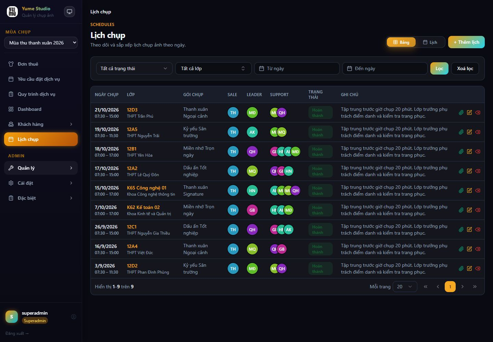
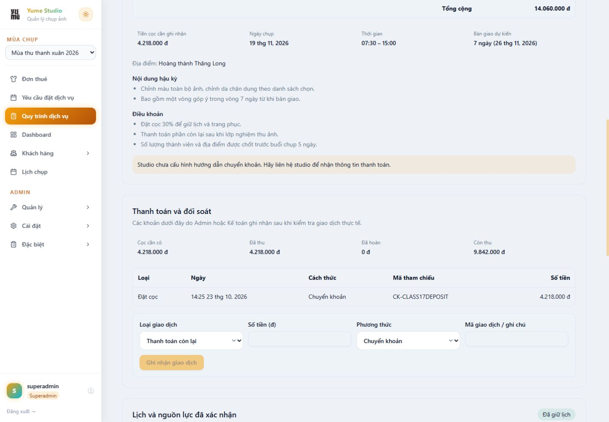

# Admin/staff — audit và kế hoạch refactor style

Audit thực hiện ngày **28–29/10/2026**, Asia/Bangkok, trên ứng dụng local hiện có. Tài liệu này là nguồn quy chuẩn và checklist triển khai cho giao diện nội bộ. **Đã hoàn thành R01–R07 ngày 29/10; R08–R18 còn lại.** Kết quả và bằng chứng: [QA foundation](docs/design/admin-staff-foundation-qa-2026-10-29.md), [QA control và pilot](docs/design/admin-staff-controls-qa-2026-10-29.md).

Bản tham chiếu Linear ban đầu được lưu nguyên vẹn tại [admin-staff-reference-linear.md](docs/design/admin-staff-reference-linear.md). Bản đó là mô tả **marketing site**, không phải đặc tả dashboard nghiệp vụ. Những quy tắc về hero 56–80px, section 96px, pricing cards, footer marketing và dark-only không áp dụng nguyên xi vào Yume.

## 1. Kết luận và phạm vi

**Cần refactor theo hệ thống, bắt đầu từ scope/theme và component dùng chung.** Đổi vài mã màu trong `index.css` sẽ không giải quyết được sự lệch control, trạng thái tối, bảng thao tác và các trang chi tiết.

Hướng refactor: kế thừa tính gọn, ít hiệu ứng và accent lavender của tài liệu Linear; chuyển thành giao diện làm việc có **sáng/tối/hệ thống**, bảng dễ đọc, thao tác rõ và form nhất quán. Scope, palette và shell nền tảng đã triển khai; các pattern và màn nghiệp vụ tiếp tục theo checklist bên dưới.

### Trong phạm vi

- Shell nội bộ: sidebar, mobile menu, breadcrumb, chọn mùa, chọn theme, hồ sơ nhân viên.
- Dashboard; lớp/thành viên; yêu cầu chụp và hồ sơ quy trình; lịch chụp; đơn thuê; kho/danh mục/gói; tài chính/báo cáo; người dùng/mùa/phản hồi; đăng nhập/đăng ký nhân sự.
- Token màu, typography, spacing, radius, elevation, control density; hover/focus/disabled/loading/error/empty; bảng, modal, popover và responsive.
- Sửa semantics/focus/nhãn khi cần để control đã có sử dụng được bằng bàn phím và công nghệ hỗ trợ.

### Ranh giới cần giữ

- Customer theo [DESIGN-customer.md](DESIGN-customer.md); không đưa theme nội bộ vào `/account/*`, `/costumes`, `/rental/start`, trang công khai hoặc form thành viên.
- Giữ API, phân quyền, idempotency, trạng thái hồ sơ, giá/cọc/thu–hoàn tiền, kho và transaction. Không sửa nghiệp vụ để làm ảnh chụp trông đẹp hơn.
- Không thêm dashboard KPI, bộ lọc, navigation hay quy trình phê duyệt mới trong PR style. Những thay đổi đó cần yêu cầu nghiệp vụ riêng.
- Không thay Radix/shadcn/Tailwind, không bổ sung UI framework, không tách các controller/hook nghiệp vụ trong đợt đổi style.

## 2. Phương pháp và bằng chứng

Dùng in-app browser, frontend `localhost:4001`, backend hiện có; tài khoản mẫu admin và nhiếp ảnh gia. Không tạo, sửa, xóa đơn/lịch/kho hay ghi nhận tiền. Theme được đổi tạm để đối chiếu rồi trả về chế độ hệ thống.

- Desktop CSS viewport **1440 × 1000**; mobile **390 × 844**. Native capture có thể bỏ vài pixel cạnh: ảnh desktop thường 1434px rộng, mobile 384px; không dùng kích thước raster đó thay cho kích thước CSS.
- Tất cả ảnh dưới đây được chụp trong lượt audit này, mở file đã lưu và kiểm tra trước khi dùng. Ảnh login trắng nội dung ban đầu và capture chart giữa animation đã được loại, thay bằng ảnh đã ổn định.
- Các trang có bảng dài được chụp full page; dashboard có chart và vùng chi tiết hồ sơ dùng viewport để tránh capture giữa animation hoặc ảnh quá dài. Phạm vi hiển thị được ghi bên dưới.
- Audit chuyển qua ngày mới nên báo cáo 29/10 có kỳ đến 29/10; không so sánh số liệu đó như một thay đổi do style.

Kích thước từng ảnh và các số đo được lưu trong [evidence.json](docs/design/admin-staff-audit-2026-10-28/evidence.json). File ảnh giữ nguyên byte của capture; phần mở rộng dùng JPEG theo định dạng thực tế.

### 8 bước audit / 14 trạng thái

| Bước | Màn và trạng thái đã xem                         | Đánh giá                                                                                      | Ảnh                                                                                                                                                                                                                                  |
| ---- | ------------------------------------------------ | --------------------------------------------------------------------------------------------- | ------------------------------------------------------------------------------------------------------------------------------------------------------------------------------------------------------------------------------------ |
| 1    | Đăng nhập nhân sự, tối                           | Form có label/focus; CTA gradient và link đăng ký chưa phù hợp ngữ cảnh                       | [01](docs/design/admin-staff-audit-2026-10-28/01-staff-login.jpg)                                                                                                                                                                    |
| 2    | Dashboard admin và nhiếp ảnh gia, tối            | Menu khác theo vai trò; màu chữ/trạng thái và hiệu ứng cần chuẩn hóa                          | [02](docs/design/admin-staff-audit-2026-10-28/02-dashboard-dark.jpg), [14](docs/design/admin-staff-audit-2026-10-28/14-photographer-dashboard-dark.jpg)                                                                              |
| 3    | Danh sách lớp và modal thêm lớp, tối             | Có bảng/phân trang/modal; thao tác nhỏ, search thiếu tên truy cập                             | [03](docs/design/admin-staff-audit-2026-10-28/03-customers-dark.jpg), [04](docs/design/admin-staff-audit-2026-10-28/04-customer-modal-dark.jpg)                                                                                      |
| 4    | Lịch chụp: desktop tối/sáng, mobile sáng         | Có card mobile và không tràn ngang ở 390px; trạng thái tối, icon action và focus menu cần sửa | [05](docs/design/admin-staff-audit-2026-10-28/05-schedules-dark.jpg), [06](docs/design/admin-staff-audit-2026-10-28/06-schedules-light.jpg), [07](docs/design/admin-staff-audit-2026-10-28/07-schedules-mobile.jpg)                  |
| 5    | Kho trang phục, sáng                             | Thông tin loại/size/tình trạng đầy đủ; bảng dày và badge cần phân cấp                         | [08](docs/design/admin-staff-audit-2026-10-28/08-inventory-light.jpg)                                                                                                                                                                |
| 6    | Danh sách quy trình và chi tiết hồ sơ chụp, sáng | Đọc được nghiệp vụ; card/list/section/control chưa thống nhất                                 | [09](docs/design/admin-staff-audit-2026-10-28/09-workflow-list-light.jpg), [10](docs/design/admin-staff-audit-2026-10-28/10-workflow-detail-light.jpg), [11](docs/design/admin-staff-audit-2026-10-28/11-workflow-payment-light.jpg) |
| 7    | Chi tiết đơn thuê mẫu đã giữ hàng, sáng          | Có báo giá/cọc/giao nhận/lịch sử; mật độ và hierarchy cần đồng bộ với hồ sơ chụp              | [12](docs/design/admin-staff-audit-2026-10-28/12-rental-detail-light.jpg)                                                                                                                                                            |
| 8    | Báo cáo dịch vụ và kho, sáng                     | Số liệu có nhãn và giải thích; header/filter/table khác các màn CRUD                          | [13](docs/design/admin-staff-audit-2026-10-28/13-reports-light.jpg)                                                                                                                                                                  |

### Minh họa các vấn đề chính

**Lịch tối:** nhãn hoàn thành tối, action nhỏ, nhiều màu cùng cạnh tranh.



**Form thanh toán:** select cao 44px, input cùng hàng cao 36px, các nhóm thiếu nhịp chung.



### Giới hạn của audit

- Đã xem trực tiếp admin và photographer. Sale, cộng tác viên sale, kế toán và admin thường cần kiểm tra phiên đăng nhập riêng khi triển khai; đọc `navItems` không chứng minh mọi trạng thái theo vai trò đạt.
- Chưa walkthrough toàn bộ CRUD settings, tài chính, tất cả trạng thái đơn, calendar view, trạng thái lỗi mạng/không dữ liệu. Các màn chưa chụp nằm trong ma trận rollout, không được coi là đã đạt.
- Chưa chạy screen reader, zoom 200%, reduced-motion, Windows high-contrast hay kiểm đầy đủ tablet/320px. Đây không phải chứng nhận WCAG.
- Không gửi báo giá, nhận tiền, chốt lịch, giao/nhận trả hoặc hủy hồ sơ để kiểm tra style. Hồi quy nghiệp vụ phải dùng dữ liệu test cô lập.

## 3. Điểm đang làm tốt

1. Có primitive trong `src/components/ui`, Radix cho dialog/popover/select và các component DataTable/PageHeader/EmptyState. Có thể chuẩn hóa trên nền hiện có.
2. Theme sáng/tối/hệ thống đã hoạt động; không cần viết lại cơ chế lưu theme.
3. Lịch chuyển sang card ở mobile; đo tại 390px thấy document width bằng viewport, không tràn ngang.
4. Modal thêm lớp đưa focus vào trường đầu; label bắt buộc và focus ring nhìn thấy được. Thao tác Escape cho phép trở lại màn danh sách.
5. Menu photographer không hiện nhóm quản trị như admin. Các hồ sơ giữ nhãn nghiệp vụ về cọc/giữ kho/đối soát rõ; cần bảo toàn khi thay bố cục.

## 4. Findings có mức ưu tiên

P1 = cần xử lý trước rollout giao diện mới; P2 = ảnh hưởng tính nhất quán/hiệu quả sử dụng; P3 = polish. Không có bằng chứng P0 trong phạm vi đã xem.

| ID  | Mức | Phát hiện và bằng chứng                                                                                                                                                                                                         | Tác động / hướng sửa                                                                                                                                                             |
| --- | --- | ------------------------------------------------------------------------------------------------------------------------------------------------------------------------------------------------------------------------------- | -------------------------------------------------------------------------------------------------------------------------------------------------------------------------------- |
| A01 | P1  | 05/06: `SCHEDULE_STATUS_COLOR` dùng `text-green-800`, `text-blue-800` cho cả hai theme. Status hoàn thành tối có chữ RGB(22,101,52), nền xanh alpha 0.1 trên card RGB(21,21,30); contrast tính sau composite khoảng **2.19:1**. | Màu semantic phải có cặp sáng/tối, giữ text và icon/nhãn; không chỉ đổi màu nền hoặc dùng hue làm trạng thái duy nhất.                                                           |
| A02 | P1  | 01/03/04/05: `Button variant="gradient"` dùng chữ trắng trên #f59e0b → #22d3ee. Contrast tại hai đầu khoảng **2.15:1 / 1.81:1**.                                                                                                | Primary dùng màu đặc, foreground đạt tương phản; bỏ gradient/glow khỏi thao tác nghiệp vụ.                                                                                       |
| A03 | P1  | 05 + DOM: ba action mỗi dòng lịch có hit box **16 × 16px**, không `aria-label`, không `title`; AX chỉ đọc “button”. 03: Sửa/Xóa cao 16px.                                                                                       | Icon nhỏ có thể giữ, vùng bấm tăng; accessible name gắn hành động và dòng, tooltip chỉ bổ sung. Không khẳng định mọi nút 16px tự động vi phạm chuẩn vì còn ngoại lệ khoảng cách. |
| A04 | P1  | 07 + kiểm bàn phím: sidebar đóng chỉ translate ra trái; không inert/aria-hidden. Shift+Tab từ Mở menu đưa focus tới Đăng xuất ở **x = -224px**, hoàn toàn ngoài màn.                                                            | Menu đóng không nhận focus; khi mở quản lý focus, Escape và trả focus. Giữ nguyên tree/phân quyền nav.                                                                           |
| A05 | P1  | 02/03 + DOM: season select không id/label kết nối; search lớp chỉ có placeholder, AX không có tên.                                                                                                                              | Bổ sung label/aria-label, gắn lỗi/hint với field; audit các icon/filter còn lại theo cùng quy tắc.                                                                               |
| A06 | P2  | 11 + DOM: hai select cao **44px**, hai input cao **36px** trong cùng cụm; 04 control 36px. `OrderSelect` nhánh staff là select native với class đặt tại trang.                                                                  | Một density cho cả hàng; chuẩn hóa native select/input/textarea, không ép Radix vào các handler native.                                                                          |
| A07 | P2  | 02–14 + code: token shadcn, legacy CSS variables, utility màu cụ thể, inline style và nhánh customer/staff cùng tồn tại.                                                                                                        | Scope theme trước, map alias tương thích; thay dần từng màn. Không đổi `:root` toàn site sang palette mới.                                                                       |
| A08 | P2  | Tài liệu gốc mô tả marketing dark-only, font Linear độc quyền, hero 80px, pricing/testimonial/footer; thực tế UI là phần mềm có light/dark.                                                                                     | Giữ làm nguồn tham chiếu; quy chuẩn sản phẩm phải có token và mẫu table/form/detail cụ thể trong file này.                                                                       |
| A09 | P2  | 02/03/08/09/10/12/13: active nav phát sáng, nút gradient, link amber trên nền sáng và màu KPI riêng lẻ.                                                                                                                         | Accent dành cho action/focus/selection; trạng thái dùng semantic, chart được phép nhiều màu khi có legend. Không áp quy tắc marketing “chỉ một màu” lên biểu đồ nghiệp vụ.       |
| A10 | P2  | 03/05: header bảng uppercase 12px; cột nhãn/trường/trạng thái xuống dòng, tên support chỉ là avatar chồng nhau, ghi chú dài cạnh action sát nhau.                                                                               | Quy định độ rộng/align/wrap từng loại cột, cụm action rõ, tên đầy đủ có cách xem; giữ card mobile đang hoạt động.                                                                |
| A11 | P2  | 09–13: detail chụp/thuê dùng card và section khác nhau; heading cùng cấp có 14px/18px; hồ sơ chụp mẫu dài khoảng 3083px.                                                                                                        | Chung nhịp section, summary/metadata, money block và action group. Không tự thêm tab/accordion giấu hành động hay thay thứ tự nghiệp vụ trong PR style.                          |
| A12 | P2  | 02/03/10 + DOM/code: brand sidebar là h1, PageHeader là h2; hồ sơ chụp có `main` lồng `main`.                                                                                                                                   | Một main/heading chính đúng cho màn; logo không chiếm vai trò tiêu đề trang. Chỉ thay semantics có kiểm hồi quy.                                                                 |
| A13 | P2  | 01: `/staff/login` có link “Đăng ký khách hàng”; logo/chữ gradient và nền blob khác hướng nội bộ gọn.                                                                                                                           | Phân biệt đúng entry nhân sự/khách, điều chỉnh copy/link bằng route đã có; không đổi luồng auth hoặc cấp quyền.                                                                  |
| A14 | P3  | 02/08/12/13: số tiền, metadata, ngày và khoảng đệm chưa có quy tắc xuyên trang; nền/viền/card khác nhau.                                                                                                                        | Tabular numerals, số tiền căn phải, radius/spacing và định dạng hiển thị nhất quán; giữ ý nghĩa “giá trị dịch vụ”, “thu–chi”, “cọc”.                                             |

Các tỷ lệ trên tính từ mã CSS/computed styles, không suy từ màu pixel ảnh. Chúng chỉ áp dụng đúng các cặp đã đo; cần kiểm thêm hover/focus/disabled và vùng gradient trung gian khi triển khai.

## 5. Quy chuẩn style đích — đề xuất triển khai

### 5.1. Theme có scope và nguồn token

- Dùng **một bộ semantic tokens cho staff**, định nghĩa ở `src/styles/admin-staff.css` dự kiến; primitive hiện có tiếp tục dùng `--background`, `--primary`, `--border`…
- Marker route-level trên root, ví dụ `html[data-app-surface="staff"]`, chỉ hoạt động khi đang ở shell/trang auth nội bộ; cleanup khi rời route. Không suy surface từ role đăng nhập.
- Marker trên root cho phép portal Radix dưới `body` kế thừa cùng theme. Tránh chỉ đặt variables trên wrapper rồi để modal/popover rơi về theme cũ.
- Legacy `--page-bg`, `--sidebar-bg`, `--card-bg`, `--input-*` được map từ cùng semantic tokens trong staff scope, như lớp tương thích trong thời gian migrate. Không duy trì hai palette độc lập.
- Không đổi theme customer; kiểm cả điều hướng staff → customer và customer → staff, modal/select/date-picker/toast, light/dark và refresh.

### 5.2. Palette đề xuất

Palette này đã được áp dụng trong R01–R02. Input dùng token viền riêng (#808793 sáng, #737c8c tối) để đạt tương phản cần thiết, tách khỏi border trang trí của card/table. Chi tiết số đo nằm trong QA foundation.

| Token          | Sáng    | Tối     | Vai trò                                    |
| -------------- | ------- | ------- | ------------------------------------------ |
| canvas         | #f6f7f9 | #0f1012 | nền làm việc                               |
| surface        | #ffffff | #17181c | card/table/dialog                          |
| surface-raised | #f0f2f6 | #202127 | hover/section phụ                          |
| ink            | #1c1e24 | #f1f2f4 | chữ chính                                  |
| ink-muted      | #5d6472 | #a7adb8 | mô tả/metadata vẫn cần đọc                 |
| border         | #d4d7de | #383b45 | hairline/phân nhóm                         |
| primary        | #5e6ad2 | #5e6ad2 | nút chính, selected action                 |
| on-primary     | #ffffff | #ffffff | contrast với primary khoảng 4.70:1         |
| primary-hover  | #5360c8 | #5360c8 | không dùng hover #828fff với chữ trắng     |
| link / focus   | #4d5bc5 | #9ca8ff | link và focus nhìn thấy trên nền tương ứng |

Semantic success/warning/danger/info có **foreground + background + border riêng cho từng theme**, map theo ý nghĩa trạng thái, không map nhầm mọi trạng thái sang accent. Ngưỡng nghiệm thu: chữ thường ≥4.5:1; chữ lớn ≥3:1; đường bao/focus cần thiết ≥3:1 với nền liền kề. Không coi disabled opacity là cách làm nội dung hướng dẫn biến mất.

### 5.3. Typography, spacing và density

| Thành phần              | Quy chuẩn                                                                                                                                            |
| ----------------------- | ---------------------------------------------------------------------------------------------------------------------------------------------------- |
| Font                    | Dùng system sans hiện có, hỗ trợ dấu tiếng Việt; không dùng Linear Display/Text độc quyền, không tải font mới chỉ để đổi style                       |
| Tiêu đề trang           | 24/32px, weight 600; một h1 trong main                                                                                                               |
| Tiêu đề section         | 18/26px, weight 600; cấp nhỏ 16/24px                                                                                                                 |
| Nội dung / bảng / field | 14/22px; label 14/20px; caption 12/18px chỉ cho thông tin phụ                                                                                        |
| Số tiền / lượng / ngày  | tabular numerals khi cần đối chiếu; số tiền căn phải; đơn vị và kỳ hiển thị rõ                                                                       |
| Spacing                 | 4, 8, 12, 16, 24, 32px; page padding 24 desktop / 16 mobile; gap section 24                                                                          |
| Radius                  | control 6px; panel/table 8px; dialog 10px; pill chỉ cho badge/avatar phù hợp                                                                         |
| Elevation               | panel phẳng + viền; shadow nhẹ cho lớp nổi; bỏ glow/gradient/hover nhấc cả card nghiệp vụ                                                            |
| Control desktop         | input/select/button cùng hàng cao 36px; icon-button vùng bấm ≥32px; không thu nhỏ vùng bấm bằng kích thước icon                                      |
| Touch                   | control/action chính ≥44px; tăng bằng media phù hợp, không làm chữ nhỏ để nhét vừa                                                                   |
| Bảng                    | body 14px; hàng thường tối thiểu 44px, wrap thì tăng; header rõ, căn số phải; action có tên; không ép mọi bảng vào cùng một mật độ nếu nội dung khác |

### 5.4. Pattern bắt buộc

- **Shell:** giữ sidebar 240px ở desktop, đường dẫn và context mùa hiện có; chọn nav bằng nền nhẹ + chỉ báo, không glow. Mobile drawer đóng phải ra khỏi tab order; mở có tên, focus và Escape/close.
- **Page header:** tiêu đề, mô tả, action chính rõ; reuse PageHeader, cho phép semantic heading phù hợp mà không phá consumer ngoài staff.
- **Toolbar:** search/filter có label, chiều cao và baseline chung; wrap xuống dòng; giữ giá trị và hành vi submit hiện có.
- **Table/list:** không giấu dữ liệu quan trọng bằng truncate không có cách đọc; action rõ ngữ cảnh. Chỉ scroll trong vùng table khi cần, không làm cả document tràn ngang.
- **Form:** field required/hint/error rõ, nối `aria-describedby`, focus-visible có contrast; label không thay bằng placeholder. Form lỗi không bị reset, nút busy/disabled có phản hồi.
- **Dialog/popover:** cùng theme portal; header/body/footer rõ; vùng cuộn và nút đóng sử dụng được ở 390px; Esc/focus trap/return-focus giữ đúng hành vi Radix.
- **Chi tiết hồ sơ:** metadata và trạng thái ở đầu, từng section có tên và money rows dễ đối chiếu; hành động gắn đúng nhóm. Không đổi quyền, điều kiện hoặc payload action.
- **Biểu đồ:** giữ legend, tooltip, đơn vị và phân biệt series ngoài hue; không biến thu–chi thành lợi nhuận vì lý do copy hoặc màu.
- **States:** cùng component phải có normal/hover/focus/active/disabled/busy/error/empty; giảm motion theo lựa chọn hệ điều hành khi có transition.

## 6. Bản đồ code và hướng xử lý

| Nguồn hiện tại                                           | Vấn đề / cách migrate                                                                                                                             |
| -------------------------------------------------------- | ------------------------------------------------------------------------------------------------------------------------------------------------- |
| `src/index.css`                                          | Cả shadcn tokens và legacy variables/rules; staff override có scope trước, chưa xóa đại trà                                                       |
| `tailwind.config.js`                                     | Có literal primary-50…700 và glow; giữ API token trong quá độ, đổi consumer staff sang semantic trước khi dọn                                     |
| `src/context/ThemeContext.tsx`                           | Giữ API sáng/tối/system và lưu preference; không đổi default sang dark-only                                                                       |
| `src/components/Layout/{Layout,Sidebar,Breadcrumbs}.tsx` | Shell/inline style/focus mobile; chuyển style vào token/class và sửa nhãn/semantics có kiểm chứng                                                 |
| `src/components/ui/*`                                    | Reuse Button/Input/Select/Badge/DataTable/PageHeader/Modal/Dialog/DatePicker; bỏ hard-code accent theo từng primitive                             |
| `src/utils/scheduleConstants.ts`                         | Tách ý nghĩa trạng thái khỏi lớp màu light-only; có variant theo theme                                                                            |
| `src/components/customer/CustomerOrderControls.tsx`      | Adapter dùng chung: staff fallback và customer branch cần giữ riêng; không “đổi tên folder” hoặc đổi select native thành Radix trong một PR style |
| `src/pages/BookingWorkflowDetailPage.tsx`                | Khoảng 3180 dòng; chỉ đổi presentation từng section, không gộp tái cấu trúc nghiệp vụ                                                             |
| `src/pages/RentalDetailPage.tsx`                         | Khoảng 1312 dòng, dùng chung theo role; style staff phải có kiểm hồi quy customer                                                                 |
| `src/pages/SchedulesPage.tsx`                            | Khoảng 1674 dòng, cả table/card/calendar/modal; pilot kiểm từng view, giữ card mobile                                                             |

Số dòng chỉ mô tả working tree lúc audit, không phải chỉ tiêu cần giảm. Không đánh đồng mọi inline style với lỗi: màu avatar/series hoặc giá trị vị trí động có thể hợp lệ; ưu tiên hard-code theme và trạng thái tương tác.

## 7. Kế hoạch refactor theo lát cắt

**R01–R07 đã triển khai và kiểm tra; R08–R18 chưa triển khai.** Mỗi lát cắt là một thay đổi review riêng; không mass-replace class toàn dự án. Đường dẫn bên dưới tương đối với `frontend/`. File test bổ sung chỉ cho hành vi thực sự có nguy cơ thay đổi, không snapshot implementation hàng loạt.

### Đợt A — nền tảng và vấn đề P1

- [x] **R01 — Scope theme và alias tương thích.** Phụ thuộc: không. File chính: `src/styles/admin-staff.css` mới, `Layout.tsx`, `LoginPage.tsx`, boundary dùng chung nếu cần (≤4 file source). Nghiệm thu: marker có cleanup; overlay portal cùng theme; customer không nhận token staff. Kiểm: chuyển route hai chiều + modal/popover sáng/tối; CustomerScope và Sidebar tests hiện có.
- [x] **R02 — Palette, contrast và status.** Phụ thuộc R01. File: staff CSS, `ui/button.tsx`, `ui/badge.tsx`, `utils/scheduleConstants.ts`. Nghiệm thu: A01/A02 hết lỗi ở normal/hover/focus; nút chính solid; lịch pending/confirmed/completed/cancelled đọc được ở hai theme. Kiểm: bảng contrast có background composite + ảnh 05/06 đối chiếu.
- [x] **R03 — Shell và mobile focus.** Phụ thuộc R01. File: `Layout.tsx`, `Sidebar.tsx`, staff CSS, `Sidebar.test.tsx`. Nghiệm thu: menu đóng không focus được; mở/đóng/Escape/trả focus đúng; chọn mùa có label, brand không làm h1 trang. Kiểm: tái hiện Shift+Tab ở 390px, tab/Enter/Escape, role admin/photographer; giữ đường dẫn/nav state.

**Checkpoint A:** chưa chuyển hàng loạt page. Pilot shell + một bảng + một modal phải có ảnh sáng/tối, keyboard pass và customer regression pass trước khi dùng cho các màn khác.

Đã đạt checkpoint A ngày 29/10/2026: 93 kiểm thử liên quan pass, TypeScript/build pass, kiểm browser hai theme, drawer mobile và route customer; xem [QA foundation](docs/design/admin-staff-foundation-qa-2026-10-29.md). Search và action lớp đã được xử lý ở R07; action dòng lịch vẫn thuộc R08.

### Đợt B — control và một màn pilot

- [x] **R04 — Field/control thống nhất.** Phụ thuộc R01/R02. File: `ui/input.tsx`, `ui/select.tsx`, `ui/form-field.tsx`, `customer/CustomerOrderControls.tsx` (≤4 file source; rule staff tại CSS R01). Nghiệm thu: input/select cùng density; label/hint/error nối đúng; customer adapter giữ giao diện và native event contract. Kiểm: form 04 và 11, lỗi/disabled/busy, DailyRentalPricing + CustomerScope regression.
- [x] **R05 — Header, bảng và action.** Phụ thuộc R02/R04. File: `ui/page-header.tsx`, `ui/data-table.tsx`, `ui/table.tsx`, `ui/pagination.tsx`. Nghiệm thu: heading hợp lý, số/tiền align, wrap/scroll có chủ đích; API bảng cũ tương thích. Kiểm: dữ liệu dài, empty/loading, phân trang, bàn phím và 390/768/1440px.
- [x] **R06 — Dialog và date/popover.** Phụ thuộc R01/R04. File: `ui/dialog.tsx`, `ui/modal.tsx`, `ui/date-picker.tsx`, `ui/popover.tsx`, hook style trong `ui/calendar.tsx`. Nghiệm thu: portal đúng theme; focus/close/clear-date có tên và vùng bấm; không cắt footer ở mobile. Kiểm: Tab/Shift+Tab/Escape, chọn/xóa ngày, overflow nội dung dài.
- [x] **R07 — Pilot danh sách lớp + modal.** Phụ thuộc R03–R06. File: `pages/CustomersPage.tsx`, `ui/search-input.tsx`, staff CSS và focused tests. Nghiệm thu: search có tên, action dòng đủ vùng bấm và ngữ cảnh, CTA/header/form đồng bộ; không đổi schema/default dữ liệu. Kiểm: search/pagination/open/close/validation, ảnh 03/04 và customer smoke.

**Checkpoint B đã đạt ngày 29/10/2026:** 113/113 tests liên quan, TypeScript/build pass; kiểm pilot sáng/tối, 320/390/768/1280/1440px, cuộn bảng bằng bàn phím, modal dài và catalog khách. Xem [QA control và pilot](docs/design/admin-staff-controls-qa-2026-10-29.md). API pattern đã có; rollout semantics/field wiring tại các trang còn lại tiếp tục theo R08–R18.

### Đợt C — lịch, kho và số liệu

- [ ] **R08 — Lịch chụp.** Phụ thuộc R07. File: `SchedulesPage.tsx`, staff CSS, focused a11y test nếu cần. Nghiệm thu: A01/A03 được sửa ở table; card mobile giữ đủ nội dung; calendar/modal cùng token. Kiểm: table/calendar, lọc/reset, action names, mobile menu và tình trạng lịch; không gửi thao tác ghi trên DB đang dùng.
- [ ] **R09 — Kho và danh mục.** Phụ thuộc R07. File: `CostumesPage.tsx`, `CostumeTypesPage.tsx`, `PackagesPage.tsx`, `CategoriesPage.tsx`. Nghiệm thu: table/form/badge cùng pattern, giá/ngày–tồn tốt–tình trạng tách rõ; không diễn giải tồn tốt thành khả dụng theo kỳ. Kiểm: mở form/nhập lỗi/đóng, danh sách dài và size, dữ liệu test cho lưu/sửa.
- [ ] **R10 — Dashboard theo vai trò.** Phụ thuộc R08. File: `DashboardPage.tsx`, `ui/stat-card.tsx`, staff CSS nếu cần. Nghiệm thu: KPI/link/status đọc được sáng/tối; chart giữ legend/đơn vị; không hiện thêm quyền hoặc KPI cho photographer. Kiểm: admin/photographer, trạng thái chart ổn định, 02/14, reduced-motion.
- [ ] **R11 — Tài chính và báo cáo.** Phụ thuộc R05/R10. File: `FinancePage.tsx`, `ReportsPage.tsx`. Nghiệm thu: filter/control/table/money thống nhất; giữ nguyên cách tính, nhãn dòng tiền/giá trị/cọc/công nợ và link hồ sơ. Kiểm: cùng kỳ/data trước–sau, tab report, pagination, kế toán/admin; số liệu không đổi vì đổi style.

**Checkpoint C:** pilot mở rộng đạt các viewport 390/768/1280/1440 và hai theme; tồn kho, lọc ngày và số liệu không thay đổi. Không coi ảnh đẹp là kiểm chứng số liệu.

### Đợt D — hồ sơ dịch vụ và các màn còn lại

- [ ] **R12 — Intake và danh sách quy trình.** Phụ thuộc R07/R11. File: `BookingsPage.tsx`, `BookingWorkflowListPage.tsx`. Nghiệm thu: header/list/status/empty/error đồng bộ; giữ phân trang và entry tới hồ sơ. Kiểm: mở hồ sơ, back, pending/rejected/approved/completed trên fixture, không xét duyệt hồ sơ đang dùng.
- [ ] **R13 — Chi tiết quy trình chụp.** Phụ thuộc R04/R06/R12. File: `BookingWorkflowDetailPage.tsx`, staff CSS, focused regression test nếu cần. Nghiệm thu: metadata/quote/payment/resources/delivery/history cùng hierarchy; sửa nested main; customer branch giữ nguyên. Kiểm: các role liên quan, quote/thu–hoàn/thành viên/bàn giao/change states trên DB test; ảnh 10/11 đối chiếu.
- [ ] **R14 — Đơn thuê staff.** Phụ thuộc R13. File: `RentalListPage.tsx`, `RentalDetailPage.tsx`, staff CSS nếu cần. Nghiệm thu: chung vocabulary với hồ sơ chụp; cọc/tiền thuê/hoàn/giao nhận phân biệt; không thay điều kiện action hoặc default-open rental. Kiểm: requested/quoted/confirmed/checked_out/returned/completed/cancelled trên fixture; DailyRentalPricing và customer detail regression.
- [ ] **R15 — Lớp và thành viên chi tiết.** Phụ thuộc R09/R13. File: `CustomerDetailPage.tsx`, `CustomerSizePage.tsx`. Nghiệm thu: form/bảng/size/actions dùng pattern đã chốt; tên dài và trường tiếng Việt đọc được. Kiểm: phân trang/tab/validation và link form public; dữ liệu thành viên không đổi.
- [ ] **R16 — Quản trị phụ trợ.** Phụ thuộc R09/R11. File: `UsersPage.tsx`, `SeasonPage.tsx`, `FeedbackPage.tsx`. Nghiệm thu: không còn style riêng về header/control/badge; quyền và trạng thái duyệt giữ nguyên. Kiểm: admin thường/superadmin, modal dài/empty/error; không thêm thao tác cấp quyền trong audit.
- [ ] **R17 — Auth và profile staff.** Phụ thuộc R03/R04/R06. File: `LoginPage.tsx`, `RegisterRequestPage.tsx`, `ProfilePage.tsx`. Nghiệm thu: bỏ trang trí marketing, entry nhân sự đúng ngữ cảnh; đổi theme/profile/password không thay contract; customer auth/profile không đổi. Kiểm: login/logout, form lỗi, tab order và redirect; kiểm password bằng tài khoản test, không đổi mật khẩu người dùng.

### Đợt E — đóng vòng và dọn có điều kiện

- [ ] **R18 — Regression, evidence và dọn legacy đã hết consumer.** Phụ thuộc R08–R17. File: staff CSS, `index.css`, `tailwind.config.js`, tài liệu QA; chỉ chỉnh phần xác nhận không còn dùng. Nghiệm thu: mọi route trong ma trận có kết quả; customer baseline không lệch; không còn P1 mở, P2 còn lại phải ghi rõ. Kiểm: type/lint/build, các test liên quan, E2E bằng DB test và capture cuối. Không đặt mục tiêu xóa toàn bộ legacy khi public/customer vẫn còn consumer.

**Checkpoint hoàn tất:** từng task có diff review được, evidence và kết quả kiểm thực tế. Checklist chỉ đánh dấu khi đạt; không dùng “đã đọc code” thay cho “đã kiểm màn”.

## 8. Ma trận nghiệm thu refactor

| Trục            | Tối thiểu phải kiểm khi triển khai                                                                                      |
| --------------- | ----------------------------------------------------------------------------------------------------------------------- |
| Role            | superadmin, admin, sale, photographer, cộng tác viên sale, kế toán; route không có quyền vẫn bị chặn                    |
| Theme           | light/dark/system; refresh; đổi theme khi dialog/popover mở; staff ↔ customer                                           |
| Viewport        | 390, 768, 1280, 1440px; bổ sung 320px và zoom 200% cho reflow; bảng được scroll nội bộ khi hợp lý                       |
| Keyboard        | Tab/Shift+Tab, Enter/Space, Escape; menu đóng không nhận focus; focus không mất/ra ngoài màn                            |
| States          | loading, empty, error+retry, long text, disabled, busy, required/validation; không phải tạo mọi state bằng dữ liệu thật |
| Money/inventory | nhãn/số tiền/ngày/size không đổi; hành vi giữ kho và các action nghiệp vụ hồi quy trên DB test                          |
| Customer guard  | login, booking wizard, orders, catalog, rental form/detail, public member intake và các overlay giữ style hiện hành     |
| Visual          | trước/sau cùng role/theme/data/viewport; screenshot ổn định, không chart animation/loading; inspect file đã lưu         |

Lệnh dự kiến, chạy từ `frontend/` khi refactor:

```powershell
node ../node_modules/typescript/bin/tsc --noEmit
node ../node_modules/eslint/bin/eslint.js <cac-file-da-sua>
node ../node_modules/prettier/bin/prettier.cjs --check <cac-file-da-sua>
node ../node_modules/vitest/vitest.mjs run src/components/Layout/Sidebar.test.tsx src/components/Layout/Breadcrumbs.test.tsx src/components/customer/CustomerScope.test.tsx src/pages/DailyRentalPricing.test.tsx
node ../node_modules/vite/bin/vite.js build
```

Đây là lệnh dự kiến, **không phải kết quả pass của lượt audit**. E2E chọn các hành trình thực sự bị ảnh hưởng trong harness hiện có; không chạy setup/teardown vào `studio_db`. Nếu runtime yêu cầu quyền đọc ngoài sandbox, ghi đúng kết quả thay vì gọi lỗi khởi động là test failure nghiệp vụ.

## 9. Rủi ro và quyết định cần giữ

| Rủi ro                                           | Kiểm soát                                                                         |
| ------------------------------------------------ | --------------------------------------------------------------------------------- |
| Sửa primitive làm customer đổi style             | staff root marker, customer regression và route-transition trước rollout          |
| Radix portal không kế thừa token wrapper         | scope có chủ đích ở root; test modal/select/popover/toast                         |
| File detail lớn bị trộn style với refactor logic | R13/R14 chỉ presentation, diff nhỏ theo section, giữ payload/guards               |
| Xóa legacy còn consumer                          | kiểm usage và route; chỉ xóa selector đã chứng minh hết dùng                      |
| Giảm mật độ quá mức hoặc làm mọi thứ thành card  | pilot bằng dữ liệu dài/bảng thực; giữ table desktop và card mobile nơi đã phù hợp |
| Màu đẹp nhưng không đủ contrast                  | đo foreground/background composite ở từng state, giữ text/icon cho semantic       |
| Tài liệu khiến người đọc tưởng đã refactor       | giữ `status` đúng tiến độ; chỉ đánh dấu task có evidence triển khai               |

Bước tiếp theo: **R08 → R09 → R10/R11**, áp dụng pattern vào lịch chụp, kho và dashboard/báo cáo trên nền R01–R07 đã có. Không thay class hàng loạt hoặc viết lại logic trang hồ sơ lớn trong PR style.
