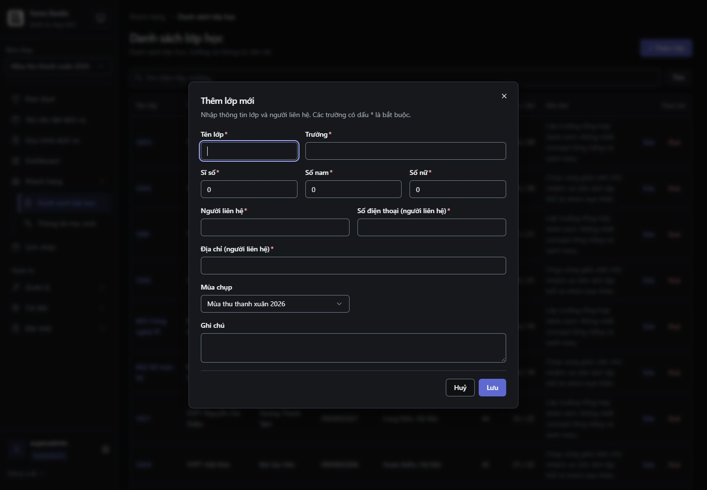

# Admin/staff — control và pilot R04–R07

Ngày kiểm: 29/10/2026, Asia/Bangkok. **Checkpoint B hoàn thành; R08–R18 còn lại.** Kế hoạch: [DESIGN-admin-staff.md](../../DESIGN-admin-staff.md).

## Đã thay đổi

- **R04:** input, Radix select và native OrderSelect cùng cao 36px desktop / 44px mobile trong staff scope. Native select giữ `onChange(event)`, ref, value và disabled; bỏ mũi tên native trùng với icon đã có. Customer adapter giữ nhánh hiện tại. FormField nối hint/error, required và invalid với control có id khớp htmlFor; thêm render function để chuyển các props này tới trigger nằm trong Controller. Không đổi validation/default/schema.
- **R05:** PageHeader cho phép chọn h1, mặc định h2 để giữ tương thích. Header wrap khi thiếu chỗ; sửa được tràn ngang ở 768px của màn lịch. Bảng có tên, vùng cuộn nhận focus, header cột và số căn phải có tabular numerals; bỏ một lớp overflow dư. Pagination có tên, trang hiện tại và nhãn page size. Loading có thông báo trạng thái.
- **R06:** dialog có khoảng cách cạnh, vùng cuộn và nút Đóng 32px / 44px. Modal dùng DialogDescription đúng liên kết; không khai báo mô tả trống. Kiểm browser phát hiện modal điều khiển bằng state mất focus khi đóng; primitive nay trả focus về opener và vẫn tôn trọng callback autofocus của caller. DatePicker dùng hai button ngang cấp để chọn/xóa ngày, bỏ interactive element lồng nhau; xóa trả focus về trigger. Popover/calendar dùng theme staff và bỏ thanh gradient trong scope này.
- **R07:** danh sách lớp có h1, search có tên, lỗi tải kèm Thử lại, empty search rõ hơn. Nút Sửa/Xoá có tên lớp/trường, vùng bấm 48 × 32px desktop / 48 × 44px mobile. Ghi chú được đọc đầy đủ; hàng tăng chiều cao theo nội dung. Mobile có phân trang dùng cùng state với desktop. Modal chia cột lại để label liên hệ không bị ép; giữ dữ liệu khi lỗi và hiện Đang lưu khi submit.

Không thêm dependency, sửa API, quyền hoặc xử lý kho/tiền. Browser chỉ đọc dữ liệu, mở/đóng form và thử submit form rỗng bị validation chặn. Không tạo/sửa/xóa lớp hoặc ghi nhận tiền trong database. Các kiểm tra payload thành công dùng service mock.

## Kiểm tra tự động

| Kiểm tra                       | Kết quả                                                                               |
| ------------------------------ | ------------------------------------------------------------------------------------- |
| TypeScript `tsc --noEmit`      | Pass                                                                                  |
| ESLint 17 file TS/TSX của đợt  | 0 errors; 1 warning `buildParams` trong effect CustomersPage đã có trước đợt refactor |
| Vitest 11 file liên quan       | **113/113 pass**                                                                      |
| Vite build sau chỉnh cuối      | Pass, 49.10 giây                                                                      |
| Prettier và `git diff --check` | Pass                                                                                  |

Hai file kiểm thử mới bao phủ FormField khi lỗi đổi, native select ở hai appearance, date clear, server/client pagination, action không kích hoạt row navigation, loading/empty, mô tả modal và return focus. Test pilot dùng reducer thật/service mock: Enter tìm kiếm, xóa, season/page, defaults, form lỗi không gửi, dữ liệu sửa và payload update, busy state, lỗi đọc/thử lại.

Bộ hồi quy gồm CustomerControls, DailyRentalPricing, StaffScope, CustomerScope, Sidebar, Breadcrumbs, CustomerHeader, App và CustomerForms. Không chạy automated E2E trong đợt này. Runtime Vitest/Vite cần quyền đọc thư mục cha ngoài sandbox; lượt khởi động bị chặn đầu tiên không được tính là test nghiệp vụ thất bại. Build còn cảnh báo dữ liệu Browserslist cũ; không cập nhật dependency trong đợt style.

## Kiểm tra browser thật

In-app browser, backend local hiện có, role superadmin. Sáng/tối/hệ thống; đã trả theme về Hệ thống.

1. Mở danh sách lớp, tìm từ khóa không có dữ liệu, xóa tìm kiếm để tải lại. Search clear trả focus vào ô nhập.
2. Desktop: input và Radix select trong modal đều 36px. Native selects và inputs của form Thanh toán và đối soát cũng đều 36px; chỉ focus ô tiền để xem, không nhập tiền hoặc gửi giao dịch.
3. Mobile 390 × 844: control 44px, dialog rộng 358px / cao tối đa 812px; form dài có scroll. Required errors nối tới field bằng aria-describedby, viền và chữ semantic danger. Tab tới Hủy có rect y=767–811 trong viewport; footer không bị mất.
4. Shift+Tab từ field đầu vòng tới Đóng; Tab trở lại field đầu. Escape đóng form và focus trở lại + Thêm lớp, thay cho BODY trước sửa. Test cũng kiểm hành vi này cho modal điều khiển bằng state.
5. Tablet 768px: table viewport 472px, nội dung bảng lớp 1120px; focus vùng cuộn và ArrowRight tăng scrollLeft 0 → 40. Document không tràn ngang. Header màn lịch cũng không còn tràn.
6. Kiểm document width ≤ viewport tại 320/390/768/1280/1440px. Đây là reflow smoke, không thay thế ma trận zoom 200% của R18.
7. DatePicker trên lịch: chọn 15/10/2026 đóng calendar, mở lại có selected màu `rgb(94,106,210)` / chữ trắng và không thanh gradient. Đóng calendar, Tab tới Xoá ngày rồi Enter xóa được, trả focus về Từ ngày, calendar không mở lại. Không nhấn Lọc để gửi/ghi thay đổi nào.
8. Catalog khách: không có marker staff, vẫn font Inter Customer, control ngày 48px và CTA hồng. Nhánh OrderSelect khách giữ class/event/ref/disabled trong test. Không tạo yêu cầu thuê.

## Bằng chứng và giới hạn

Ảnh gốc từ native browser được lưu nguyên byte trong [admin-staff-controls-2026-10-29](admin-staff-controls-2026-10-29/). Metadata: [evidence.json](admin-staff-controls-2026-10-29/evidence.json). Ảnh raster có thể thiếu vài pixel scrollbar so với CSS viewport.

- 01/05: danh sách lớp tối/sáng; đối chiếu cùng mùa và các lớp mẫu với [baseline 03](admin-staff-audit-2026-10-28/03-customers-dark.jpg).
- 02: modal tối; đối chiếu [baseline 04](admin-staff-audit-2026-10-28/04-customer-modal-dark.jpg).
- 03/04/09: lỗi form, card và phân trang mobile. Ảnh 03 chụp sau validation tự cuộn tới field lỗi.
- 06/07/08: calendar, control thanh toán và table tablet. 07 là pilot density, chưa phải refactor bố cục hồ sơ R13.
- 10: catalog khách không nhận theme staff.

Field nằm trong Controller hoặc wrapper chưa được chuyển sang render function ở màn khác vẫn cần wiring khi rollout. PageHeader của các màn khác giữ h2 đến từng đợt; chưa sửa nested main, action lịch 16px, dashboard KPI hay toàn bộ detail styles. Không coi tất cả A03/A05/A12 đã đóng trên toàn hệ thống. R08–R18, mọi role/state, screen reader và automated E2E còn theo kế hoạch.
