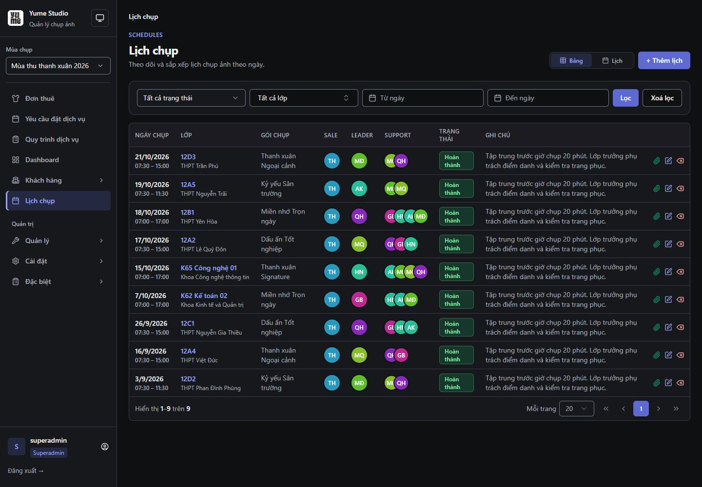
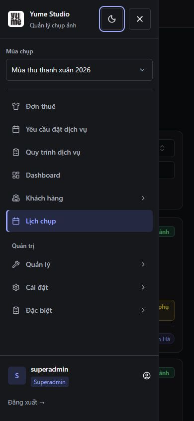

# Admin/staff foundation — R01–R03

Ngày kiểm: 29/10/2026, Asia/Bangkok. Kết quả: **hoàn thành đợt A**, chưa hoàn thành toàn bộ kế hoạch. Nguồn: [DESIGN-admin-staff.md](../../DESIGN-admin-staff.md).

## Đã thay đổi

- R01: route boundary `StaffScope` gắn `data-app-surface="staff"` trên root và cleanup khi unmount. Staff auth, shell và Radix portals dùng cùng palette. Legacy variables được map sang cùng semantic tokens trong staff scope; customer/public không có marker này.
- R02: palette sáng/tối, nút primary/gradient cũ hiển thị màu đặc, focus và input border có contrast riêng. Badge và trạng thái lịch dùng cặp foreground/background semantic. Segmented control có pressed state, bỏ gradient/glow trong staff scope. CSS giữ màu destructive của action, không biến nút xóa thành link accent.
- R03: sidebar dùng class/token thay cho inline gradient và mouse style mutations; brand không còn là h1, season select có label. Desktop giữ rộng 240px; mobile dùng Radix Dialog có focus trap, Escape, close button, return focus và đóng khi chọn route. Drawer đóng không được mount, thay cho translate một sidebar vẫn nhận focus ra ngoài màn.
- Không đổi quyền truy cập, API, business state, dữ liệu kho hoặc thu–hoàn tiền. Không lưu form hoặc chạy seed trong lúc kiểm tra.

## Kiểm tra tự động

| Kiểm tra                        | Kết quả                                                                                  |
| ------------------------------- | ---------------------------------------------------------------------------------------- |
| TypeScript `tsc --noEmit`       | Pass                                                                                     |
| ESLint các TS/TSX thay đổi      | 0 errors; 2 warning Fast Refresh đã có ở button/badge vì export cả component và variants |
| Prettier các file thay đổi      | Pass                                                                                     |
| Vitest 7 file liên quan         | **93/93 pass**                                                                           |
| `vite build` sau chỉnh CSS cuối | Pass, 26.83 giây                                                                         |
| `git diff --check`              | Pass                                                                                     |

Vitest gồm StaffScope, Sidebar, Breadcrumbs, CustomerScope, CustomerHeader, DailyRentalPricing và App. Test mới kiểm route staff → customer → staff và cleanup; closed mobile drawer không có link/logout trong DOM; focus vào drawer, Escape trả về trigger; season label, brand semantics và menu photographer giữ đúng phạm vi.

Không chạy automated Playwright E2E trong đợt này. Native browser kiểm giao diện thật; các test DOM không được coi là chứng minh CSS hoặc screen reader compliance. Build có cảnh báo dữ liệu Browserslist cũ; không cập nhật dependency trong PR style.

## Contrast

Kết quả đầy đủ: [contrast.json](admin-staff-foundation-2026-10-29/contrast.json). Tính theo relative sRGB luminance trên các cặp token opaque; đã đối chiếu computed styles của primary, status completed và input thực tế trong browser.

| Cặp                    | Trước audit                           | Sau refactor                        |
| ---------------------- | ------------------------------------- | ----------------------------------- |
| Completed lịch, tối    | 2.19:1                                | **9.24:1**                          |
| Completed lịch, sáng   | —                                     | **6.77:1**                          |
| Chữ trắng / primary    | 2.15:1 và 1.81:1 tại hai đầu gradient | **4.70:1** normal, **5.42:1** hover |
| Input border / surface | Chưa đo đầy đủ                        | **3.62:1** sáng, **4.22:1** tối     |
| Link/focus / surface   | Chưa đo đầy đủ                        | **5.80:1** sáng, **7.99:1** tối     |

16 cặp trong bảng máy đọc đều đạt ngưỡng của từng loại. Đây không phải kết luận mọi text/biểu đồ/disabled state trong toàn bộ ứng dụng đạt contrast.

## Kiểm tra browser

In-app browser, frontend và backend hiện có. Desktop CSS 1440 × 1000; mobile 390 × 844. Một số capture raster thiếu vài pixel cạnh so với CSS viewport. Ảnh lưu trực tiếp từ browser, không dựng lại UI trong ảnh.

1. Admin: dashboard/menu, lịch chụp, bảng lớp, modal thêm lớp và select portal tải được. Label mùa có accessible name. Chỉ mở/đóng form, không nhấn Lưu.
2. Chuyển sáng/tối bằng menu theme. Primary là `rgb(94,106,210)` với background image `none`; completed tối là chữ `rgb(134,239,172)` trên nền `rgb(23,55,44)`.
3. Mobile đóng: không có aside hoặc dialog trong DOM; trigger 44 × 44px, document không rộng hơn viewport. Mở drawer đưa focus vào nút Đóng menu.
4. Tab từ Đăng xuất quay lại Chế độ giao diện; Shift+Tab từ Chế độ giao diện quay lại Đăng xuất. Cả hai vẫn ở trong drawer.
5. Đổi theme qua dropdown portal trong drawer không đóng drawer. Escape đóng drawer, trả focus về Mở menu. Chọn Danh sách lớp học cũng đóng drawer và tới đúng màn.
6. Modal dưới body nhận surface và border đúng theme; focus field theo ring mới. Select portal sáng có nền trắng và chữ `rgb(28,30,36)`.
7. Staff login → link đăng ký khách hàng: marker staff bị gỡ, font Inter Customer và primary `rgb(255,56,92)` giữ nguyên. Browser Back về staff login khôi phục marker. Không đăng ký tài khoản.
8. Photographer: menu chỉ có Quy trình dịch vụ, Dashboard và Lịch chụp; không xuất hiện nhóm quản trị hoặc đơn thuê. Dashboard tải và hiển thị lịch theo role.
9. Resize drawer đang mở từ 390px sang 768px: dialog được gỡ, sidebar desktop xuất hiện; body không bị khóa pointer events, document rộng đúng 768px.
10. Desktop 1280 × 900: sidebar desktop hiển thị, document không rộng hơn viewport. Đã trả theme về Hệ thống sau kiểm tra.

Console không ghi nhận error trong phiên kiểm; có hai warning thiếu description của `DialogContent` khi kiểm modal lớp hiện có. Bổ sung mô tả dialog nằm trong đợt form, chưa đánh dấu đã sửa ở foundation.

## Evidence

Ảnh trong [admin-staff-foundation-2026-10-29](admin-staff-foundation-2026-10-29/). Các ảnh đã được mở và kiểm tra; đối chiếu lịch tối với [baseline audit](admin-staff-audit-2026-10-28/05-schedules-dark.jpg) ở cùng viewport và các dòng dữ liệu mẫu.

- `02-schedules-dark.jpg`, `03-schedules-light.jpg`: bảng lịch và shell ở hai theme.
- `01-dashboard-dark.jpg`: dashboard admin; màu KPI/biểu đồ riêng vẫn thuộc đợt sau.
- `04-mobile-drawer-dark.jpg`: drawer và các control 44px.
- `05-modal-dark.jpg`, `06-modal-light.jpg`, `07-select-portal-light.jpg`: modal và portal theo theme.
- `08-customer-guard.jpg`: customer không kế thừa palette staff.
- `09-photographer-light.jpg`: menu và dashboard theo role photographer.
- Metadata và giới hạn bằng chứng: [evidence.json](admin-staff-foundation-2026-10-29/evidence.json).

## Còn lại

R04–R18 chưa triển khai. Search lớp chưa có label mới; action dòng lịch vẫn cần tăng hit box và đặt tên ở R07/R08. PageHeader và nested main, độ cao select/input ở trang hồ sơ, date-picker decoration, dashboard KPI màu riêng, typography/card của từng màn sẽ được xử lý theo kế hoạch. Không đánh dấu toàn bộ findings P1/P2 đã hết.

Chưa kiểm toàn bộ role/state, screen reader, 200% zoom hoặc tất cả viewport của ma trận R18. Checkpoint foundation xác nhận token/scope/shell và pilot bảng/modal; không thay thế nghiệm thu mọi màn.
