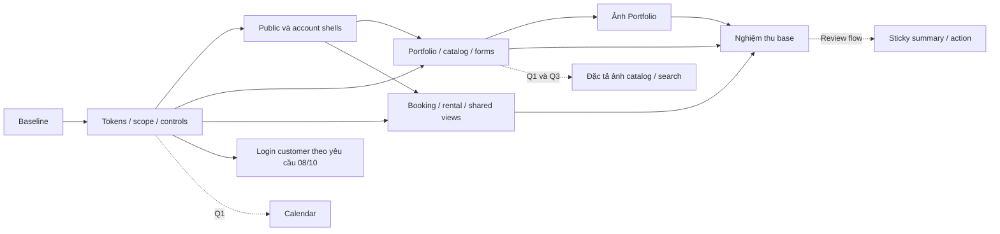

# Plan refactor UI customer

Ngày lập: 2026-10-06 (Asia/Bangkok). Cập nhật: 2026-10-13. Trạng thái: **phần cơ sở UI00–UI26, login O01–O04, appearance AUTH01 và booking BOOK01–BOOK02 đã nghiệm thu trong phạm vi Chrome local; O05–O10 còn có điều kiện**.

Nguồn: [DESIGN-customer.md](../DESIGN-customer.md), [AUDIT-customer.md](../docs/design/AUDIT-customer.md). Checklist thực hiện: [todo.md](todo.md).

`DESIGN.md` đã đổi tên thành `DESIGN-customer.md`; nội dung nguồn giữ nguyên theo SHA-256 khi lập plan. Audit giữ các references lịch sử. Mã task `UI00–UI26` tách biệt với finding `C/T/K/L/R` của audit; `O01–O10` là modules có điều kiện. `AUTH01` là đợt appearance login/register đã được user chọn riêng ngày 08/10.

`BOOK01` là đợt ba bước đặt dịch vụ theo mockup2 và hai màn tiếp theo được user duyệt09/10. Dùng ảnh/tiến trình ở rail, danh sách gói dạng hàng, form phẳng và review/details/estimate; giữ API, draft, quyền, timezone và idempotency. User đã chọn đổi tên/mô tả hai gói Demo trong preview; chỉ metadata được sửa, giữ đủ7 gói và toàn bộ ID/giá/quyền lợi. Không coi thanh chọn gói bước1 là hoàn thành toàn bộ O08 sticky estimate. [QA wizard lịch sử](../docs/design/customer-booking-wizard-qa.md) ghi phạm vi checks và giới hạn E2E; [QA auth lịch sử](../docs/design/customer-auth-layout-qa.md) giữ evidence AUTH01.

`BOOK02` là màn hồ sơ sau khi gửi theo phương án 3 đã chỉnh, được user chọn ngày 12/10 và nghiệm thu 13/10. Chỉ áp cho customer ở `pending/intake` chưa có báo giá: một liên kết quay lại danh sách, một nút tải lại, tiến trình phía trên thông tin phẳng và ảnh Yume thật. Giữ thông báo thời gian đề xuất chưa giữ lịch, sự kiện thật và các nhánh báo giá/thanh toán/staff hiện có. [QA BOOK02](../design-qa.md) ghi các checks chọn lọc và runtime Chrome local; không coi đây là hoàn tất O09 hoặc kiểm chứng giao dịch thực.

## 1. Kết quả mong muốn và phạm vi cơ sở

Chuẩn hoá các luồng khách hàng hiện có thành một giao diện marketplace nền trắng, ink và Rausch theo DESIGN. Bao phủ 14 file trang trong audit, public/account/form shells, auth bootstrap và các component presentation thực dùng. Giữ APIs, dữ liệu, quy tắc quyền, feature gates, draft, timezone, tính tiền, quote consent và request keys.

User đã cho phép bắt đầu theo plan ngày 2026-10-06. Đợt đầu thực hiện phần UI cơ sở; các câu hỏi mở rộng/login/ảnh chưa có lựa chọn cụ thể. Không suy việc cho phép bắt đầu thành lựa chọn các modules có điều kiện:

- Đợt cơ sở: UI của các luồng hiện có, native date/time được chuẩn hoá vỏ field, nội dung/data dùng nguồn hiện tại.
- Customer dùng light appearance; Inter là substitute theo DESIGN. Staff/admin giữ theme và giao diện hiện tại.
- Custom calendar, keyword search, ảnh thật catalog/concept và reservation action composition nằm trong phần có điều kiện.
- Login ban đầu nằm trong lựa chọn Q2 và được giữ legacy trong đợt cơ sở. Ngày 08/10, user yêu cầu “refactor cả login luôn”, nên O01–O04 được mở thành đợt bổ sung.
- Ngày 08/10, user chọn **phương án 2 theo thứ tự mockup đã hiển thị** cho login/register: khối câu chuyện và ảnh Yume bên trái, form phẳng bên phải; đây là AUTH01, không mở calendar/search/data catalog.
- Chưa xây trang thiết bị/phòng chụp, product detail, wishlist, upload ảnh, map, tính giá/availability mới. Audit xác nhận chúng chưa có implementation khách tương ứng.

Đã hoàn tất phần cơ sở UI00–UI26: 13 trang customer cùng shells/primitives, scoped appearance và ảnh hiện có. Đợt cơ sở ngày 08/10 đạt 47 unit tests/4 E2E, TypeScript/Prettier/build và ESLint 0 errors/8 warnings có sẵn. Login là trang thứ 14 trong audit và được refactor ở đợt bổ sung, với evidence riêng tại [customer-login-checks.md](../docs/design/customer-login-checks.md). Không cộng các tests chọn lọc của đợt login vào số 47 để gọi là full suite mới. Giới hạn OS/zoom/browser/staff pixel parity ghi rõ trong [QA-customer.md](../docs/design/QA-customer.md). DESIGN customer/admin và audit giữ nguyên. Xem [foundation lịch sử](../docs/design/QA-foundation.md), [forms](../docs/design/customer-forms-checks.md), [orders](../docs/design/customer-orders-checks.md), [images](../docs/design/customer-images-checks.md) và [baseline](../docs/design/customer-baseline.md).

## 2. Quyết định, giả định và điều kiện mở

| Mã  | Quyết định                                                  | Mặc định đề xuất khi chưa có câu trả lời                                              | Ảnh hưởng                                                                                        |
| --- | ----------------------------------------------------------- | ------------------------------------------------------------------------------------- | ------------------------------------------------------------------------------------------------ |
| Q1  | UI hiện có; UI+calendar; hoặc mở rộng thêm search/data ảnh? | UI hiện có là đợt cơ sở                                                               | O05–O07 chỉ khi bao calendar; O10 chỉ khi mở tính năng/data; ghi gaps chưa đóng                  |
| Q2  | User yêu cầu refactor login ngày 08/10                      | Implementation default đã thông báo: `/login` cho customer; `/staff/login` giữ legacy | Mở O01–O04; user chưa chọn URL cụ thể trong câu hỏi trước đó. Appearance không dùng để cấp quyền |
| Q3  | Nguồn ảnh concept và trang phục/phụ kiện?                   | Chưa có nguồn/mapping mới được cung cấp                                               | UI24–UI25 dùng ảnh Portfolio hiện có; catalog/concept ảnh thật chờ nguồn và data contract O10    |
| A1  | Font                                                        | Inter self-hosted có tiếng Việt; Cereal chỉ khi có nguồn hợp lệ                       | UI01. Tên file font trong todo là dự kiến, điều chỉnh theo font asset thực                       |
| A2  | DESIGN có mô tả mâu thuẫn                                   | Ưu tiên token/component cụ thể: card 14, control 8, spacing base 4                    | Không dùng summary button 32/card-lg~14 thay quy tắc cụ thể                                      |
| A3  | Form/cards khác domain Airbnb                               | Form widths và service/order cards có variants được ghi rõ                            | Không ép mọi form về 1280px, thẻ đơn hàng phải có ảnh, hoặc gói dịch vụ luôn 4 cột               |
| A4  | Loading/status/error outline chưa đủ trong DESIGN           | Neutral status+label/icon, error text #c13515; giữ geometry cho loading/error image   | Ghi extension; không khẳng định đây là token trạng thái đã có sẵn trong DESIGN                   |

Q2 được triển khai theo mặc định kỹ thuật đã nêu trong commentary: `/login` là route public trong CustomerScope, không phụ thuộc portal/rental flags; `/staff/login` dùng cùng LoginPage ngoài scope và giữ markup/default styles cũ. User cho phép refactor login nhưng chưa chọn chính xác hai URL này; đây là quyết định triển khai được ghi rõ, không phải một câu trả lời giả định cho câu hỏi trước đó. Cả hai entry reuse cùng auth handler, credentials, role redirects và `safeBookingReturnTo`. Customer header/register/wizard/rental tiếp tục dùng `/login`; staff Sidebar/logout và link quay lại từ staff registration dùng `/staff/login`.

Guest ở `/` vẫn đến Portfolio; customer guard đến `/login`, staff guard đến `/staff/login`. Guard vẫn chờ bootstrap, kiểm role và lưu path+search như cũ; guard không lưu hash trong baseline. LoginPage nhận safe state/query target có hash, và API 401 trên account/booking/rental resume paths giữ window query/hash như trước. API 401 trên `/auth/login` vẫn loại trừ redirect; các path khác chỉ chọn entry qua helper `loginEntryForPath`. Helper chọn presentation, không cấp quyền và không mở whitelist return URL. AuthContext, payload, draft, request keys và feature gates không đổi.

O01–O04 đã nghiệm thu: full frontend unit **14 files/73 tests**, booking/rental E2E **2/2**, check/build cuối và browser **35 nhóm** pass. Browser 23 nhóm main gồm 12 render checks trên source cuối và 11 interaction checks sau khi chờ focus transition ổn định; 12 entry checks giữ riêng. Không gọi đây là một execution duy nhất hoặc một full E2E mới: workflow-business/reports chỉ có evidence đợt base 4/4. Production build cuối 4019 modules/42.65s; preservation sau login 137 unchanged/25 expected changed, auth handler/returnTo/legacy JSX và assets gốc giữ nguyên. Xem [login evidence](../docs/design/customer-login-checks.md).

Các số O01–O04 ở trên là evidence lịch sử trước AUTH01. Bố cục hiện tại dùng `CustomerAuthLayout` chung cho customer login/register, nền story #f7f7f7, hai ảnh Portfolio `tnv00817`/`pbi00061` bản 640 và form trắng tối đa 400px. Dưới 744px, story thu gọn với ảnh chính cao 144px và ẩn ảnh phụ. Giữ Inter, title22/story28, fields56/r8, CTA48/r8 và photo14 theo DESIGN; kích thước phóng đại trong ảnh sinh không thay token nguồn. Ảnh bạn bè giữ tỷ lệ vuông tự nhiên. CSS chỉ áp dưới `.customer-ui`, staff và auth/routing/API giữ nguyên. Checks AUTH01: 3 files/19 tests, `check` và `build` pass; preservation 137/162 unchanged, 25 expected changed và 14 ảnh gốc giữ nguyên. Visual QA đã pass; xem [auth layout evidence](../docs/design/customer-auth-layout-checks.md), không gọi đây là full suite hoặc E2E đã chạy lại.

O08–O09 là thay đổi bố cục/tương tác cần review sau khi base UI ổn định. Hoàn tất base và login không có nghĩa toàn DESIGN đạt 100% khi calendar, search, ảnh thật hoặc sticky pattern còn mở.

## 3. Kiến trúc và các điều phải giữ

### Scope ở route boundary

Tạo `CustomerScope` bên ngoài `ProtectedRoute` của route account, và bao các public/standalone form routes. Scope cung cấp light palette, font, `color-scheme: light`, appearance context và tokens `--customer-*`; không tạo thêm shell hay `main` lồng. Layout chỉ xử lý header/main/footer.

Giữ `ThemeProvider`, `:root/.dark`, staff `ui/*` defaults và screens hiện có. Không gọi `setThemeMode('light')` khi vào customer. Customer-only presentation bỏ `dark:*`, amber/cyan gradients/glow và logic inline `isDark`; các file shared chọn appearance theo route scope, **không dùng appearance thay role checks**.

Có thể alias HSL/legacy vars trong scope để chuyển tiếp markup, nhưng alias không sửa được hardcoded `dark:*`, date selectors hay radius 8/14 khác vai trò. Phải kiểm cascade và migrate presentation cụ thể; không override blanket mọi `rounded-*` trong customer.

### Primitives và reuse

Đặt phần customer tại `src/components/customer/`, stylesheet `src/styles/customer.css`. API gần controls hiện có để giữ ref/type/asChild/onChange/disabled. Reuse Radix/native behavior; nếu adapter còn giữ h 36/ring/shadow/opacity của legacy thì tách presentation mỏng, không copy auth/workflow/business logic.

Chỉ thêm helpers khi có consumer: button/fields/surface/price/status, sau đó package/order/rating/feedback/image. Không tạo thêm một bộ design system hoặc overlay wrappers cho component chưa dùng.

Shared pages được migrate từng section: Profile; Bookings/RentalList; Workflow summary→customer forms/actions; Rental summary→customer forms/actions. Staff default giữ nguyên. Quyền vẫn theo current guards/role logic; route appearance không sửa hiện trạng tài khoản nhiều role hoặc điều kiện data fetch.

### Metric đích và mapping

| Role       | Contract                                                                                                                                                          |
| ---------- | ----------------------------------------------------------------------------------------------------------------------------------------------------------------- |
| Palette    | Primary #ff385c, active #e00b41, disabled #ffd1da; white CTA; ink #222222/body #3f3f3f/muted #6a6a6a; white/soft #f7f7f7/strong #f2f2f2, hairline #dddddd/#ebebeb |
| Typography | Display 28/22/21/20 theo weight/line-height/tracking DESIGN; title 16; body 16/14; caption 14/13; badge 11; không dùng rating 64 cho hero/price                   |
| Controls   | Primary/secondary 48, radius 8, label 16-500; input/select/date/time 56/radius 8/font 16; focus border 2 ink; textarea theo nội dung                              |
| Surfaces   | Card/photo 14, card meta 16/reservation 24; flat hoặc shadow tier duy nhất của DESIGN; press CTA chỉ đổi màu                                                      |
| Layout     | Spacing 2/4/8/12/16/24/32/48/64; band 64; listing gutter 16; footer gutter 24                                                                                     |
| Containers | Editorial 1280, detail 1080, listings cap 1440; narrow/standard/wide forms có ngoại lệ theo nội dung                                                              |
| Responsive | Customer aliases 744/1128/1440; property/catalog 1/2/4; service card có quy tắc riêng; mobile menu sheet                                                          |
| Images     | Property slot 1:1, experience/concept 4:5 khi có ảnh thật; editorial crop có ngoại lệ; photo clip 14, logo contain; eager hero/lazy below fold                    |

### Portal, auth loading và toast

- Auth fallback render trước ClientLayout; scope ở router phải phủ được state này. Chỉ thay loading presentation khi cần, guard logic giữ nguyên.
- Mobile menu dùng Radix Dialog có customer portal host hoặc class/tokens trên content root. Portal vào body, ngoài customer scope không thể chỉ kế thừa token từ trigger. Calendar overlay chỉ được xây ở O05.
- Giữ một ToastContainer ở app. Adapter presentation theo customer entry/route; ghi rõ toast chuyển route có dùng appearance lúc tạo hay lúc render, kiểm chứng và tránh container trùng. Staff defaults không đổi.
- TooltipProvider hiện chỉ provider; không tạo Tooltip/Popover/Select overlay customer chỉ vì barrel export có chúng.

### Hợp đồng nghiệp vụ

Giữ `safeBookingReturnTo`, query/hash/state/replace; portal/rental gates; ownership/roles; autocomplete/validation; draft session storage và clear-on-success; timezone VN→UTC/ngày nhận-trả; request/idempotency keys; current quote version/consent; sources của total/deposit/due/refund. Price component chỉ format số. Delivery hiện là link folder, không tự biến thành album/gallery.

### Điều chỉnh khi triển khai đợt đầu

UI15 chỉ dùng CustomerButton/CustomerFields và một section semantic, nên phụ thuộc UI03/UI04; price/status/card primitives ở UI05 chưa cần cho trang này. UI15 được làm sớm thành một pilot thực tế. UI02 thêm context thuần TypeScript để không tăng warning React Refresh; test scope/toast tách thành tasklet một file. Card/price/status tiếp tục ở UI05 khi có consumers.

## 4. Các giai đoạn và dependency

| Giai đoạn | Kết quả                      | Tasks                                          |
| --------- | ---------------------------- | ---------------------------------------------- |
| 0         | Baseline                     | UI00                                           |
| 1         | Nền tảng customer            | UI01, UI02, UI03, UI04, UI05                   |
| 2         | Shell và điều hướng          | UI06, UI07, UI08                               |
| 3         | Khám phá và form công khai   | UI09, UI10, UI11, UI12, UI13, UI14, UI15       |
| 4         | Đặt/thuê và các trang shared | UI16, UI17, UI18, UI19, UI20, UI21, UI22, UI23 |
| 5         | Ảnh hiện có                  | UI24, UI25                                     |
| 6         | Nghiệm thu                   | UI26                                           |



| Task | Kết quả                                       | Phụ thuộc                                                              | Rủi ro |
| ---- | --------------------------------------------- | ---------------------------------------------------------------------- | ------ |
| UI00 | Ghi baseline UI và nghiệp vụ                  | Không                                                                  | Thấp   |
| UI01 | Thêm token và font customer                   | UI00                                                                   | Thấp   |
| UI02 | Đặt scope ở route và toast                    | UI01                                                                   | Vừa    |
| UI03 | Chuẩn hoá nút customer                        | UI02                                                                   | Thấp   |
| UI04 | Chuẩn hoá field customer                      | UI02                                                                   | Vừa    |
| UI05 | Chuẩn hoá card, status và giá                 | UI03, UI04                                                             | Thấp   |
| UI06 | Chuẩn hoá public shell desktop                | UI03, UI05                                                             | Vừa    |
| UI07 | Chuẩn hoá account shell                       | UI06                                                                   | Vừa    |
| UI08 | Menu mobile customer                          | UI06, UI07                                                             | Vừa    |
| UI09 | Portfolio hero và các section tĩnh            | UI06                                                                   | Thấp   |
| UI10 | Card gói ở khám phá và chọn gói               | UI05, UI09                                                             | Vừa    |
| UI11 | Feedback inline và contact Portfolio          | UI03, UI04, UI09                                                       | Vừa    |
| UI12 | Catalog và bộ lọc hiện có                     | UI04, UI05, UI06                                                       | Vừa    |
| UI13 | Hai form thông tin thành viên                 | UI04, UI05                                                             | Vừa    |
| UI14 | Standalone feedback và submit bar             | UI05, UI11                                                             | Vừa    |
| UI15 | Đăng ký khách                                 | UI03, UI04                                                             | Thấp   |
| UI16 | Profile customer trong trang shared           | UI04, UI05, UI07                                                       | Vừa    |
| UI17 | Danh sách booking và rental customer          | UI05, UI07                                                             | Vừa    |
| UI18 | Wizard fields và review                       | UI04, UI05, UI10                                                       | Vừa    |
| UI19 | Booking detail: summary, quote và payment     | UI05, UI17                                                             | Cao    |
| UI20 | Booking detail: forms và action areas         | UI04, UI19                                                             | Cao    |
| UI21 | Rental detail: quote, payment và settlement   | UI05, UI17, UI19                                                       | Cao    |
| UI22 | Rental detail: sửa yêu cầu và gia hạn         | UI04, UI21                                                             | Cao    |
| UI23 | Form tạo đơn thuê                             | UI04, UI05, UI12                                                       | Vừa    |
| UI24 | Ảnh Portfolio và responsive collage           | UI09, UI11                                                             | Vừa    |
| UI25 | Responsive derivatives ảnh hiện có theo batch | UI24                                                                   | Vừa    |
| UI26 | Nghiệm thu và ghi các gap còn mở              | UI08, UI12, UI13, UI14, UI15, UI16, UI17, UI18, UI20, UI22, UI23, UI25 | Vừa    |

Ưu tiên theo rủi ro: tokens và primitives → public/forms chỉ khách → shells/mobile → shared profile/list/wizard/rental form → workflow/rental detail forms → modules login/calendar/data/sticky. Ảnh Portfolio hiện có (UI24–UI25) có thể làm ngay sau public slice ổn định, trước các detail tasks rủi ro cao; ảnh mới cần data nằm ở O10. Dependency trong bảng có quyền ưu tiên trước số thứ tự task.

UI25 thực hiện thành 5 tasklet A–E, mỗi tasklet tối đa 5 file ghi; không coi toàn bộ 13 assets là một task nhỏ. Mọi task chi tiết có ≤3 tiêu chí nghiệm thu và verification trong [todo.md](todo.md). UI00/UI26 là task evidence, không implementation.

### Checkpoints

| Mốc                                                              | Nội dung phải kiểm trước khi mở rộng                                                                                                                         |
| ---------------------------------------------------------------- | ------------------------------------------------------------------------------------------------------------------------------------------------------------ |
| CP0 — sau UI00                                                   | Baseline và current failures rõ; dữ liệu/test environment sẵn; ràng buộc shared được ghi                                                                     |
| CP1 — sau UI01–UI03, rồi UI04–UI05                               | Scope/tokens thử dưới html.dark, auth fallback/toast đúng; controls metrics/focus; staff default không đổi. Chưa yêu cầu toàn consumer light trước migration |
| CP2 — sau UI06–UI08                                              | Public/account shell và menu hoàn chỉnh, anchors/flags/logout/focus giữ; không rò portal/theme                                                               |
| CP3a — sau UI09–UI11; CP3b — sau UI12–UI15                       | Mỗi slice public/form có normal/loading/error/empty/success và mobile evidence                                                                               |
| CP4a — sau UI16–UI18; CP4b — sau UI19–UI20; CP4c — sau UI21–UI23 | Các customer/staff branches và booking/rental journeys giữ data/consent/request behavior                                                                     |
| CP5 — sau UI24 và mỗi batch UI25                                 | Ảnh đúng crop/loading/alt, derivatives visually accepted và đo network; originals được giữ                                                                   |
| CP6 — UI26                                                       | V-final, coverage disposition và exceptions rõ; plan không tự merge/deploy                                                                                   |
| CP mở rộng                                                       | Calendar/login/sticky/data modules có decision+contract riêng, kiểm hồi quy trước khi tick                                                                   |

CP là kiểm tra evidence, không mặc định yêu cầu user xác nhận lại sau từng task. Q1/Q3 chưa chốt chỉ ảnh hưởng các tasks có điều kiện. Phần cơ sở và login đã được user cho phép; mặc định URL của login được ghi ở Q2.

## 5. Tasks có điều kiện

| Task | Kết quả                                               | Điều kiện                                                     | Phụ thuộc        |
| ---- | ----------------------------------------------------- | ------------------------------------------------------------- | ---------------- |
| O01  | Presentation login customer; staff legacy riêng entry | Yêu cầu login 08/10                                           | UI03, UI04, UI15 |
| O02  | Nối hai login entry ở router/guard/API 401            | Mặc định kỹ thuật Q2                                          | O01              |
| O03  | Giữ customer links và nối staff links                 | Mặc định kỹ thuật Q2                                          | O02              |
| O04  | Regression auth và nghiệm thu login                   | Yêu cầu login 08/10                                           | O03              |
| O05  | Customer calendar/date contract                       | Q1 bao calendar                                               | UI04, UI08       |
| O06  | Migrate lịch ở tạo booking/rental                     | Q1 bao calendar                                               | O05, UI18, UI23  |
| O07  | Migrate lịch ở detail customer                        | Q1 bao calendar                                               | O06, UI20, UI22  |
| O08  | Sticky estimate và mobile CTA của wizard              | Chốt riêng sau nghiệm thu base UI; thay composition tương tác | UI26, UI18, UI08 |
| O09  | Sticky quote action nếu phù hợp detail                | Chốt sau review consent/quote; không phải footer chung        | O08, UI20, UI22  |
| O10  | Đặc tả ảnh thật và search catalog                     | Q1 mở rộng tính năng; ảnh phụ thuộc Q3                        | UI12, UI24       |

O10 là discovery/spec và tạo task breakdown cho data implementation sau khi đọc backend. Nó chưa triển khai ảnh/search và chưa đóng hoàn toàn K07/K12. Không gán ảnh kỷ yếu bất kỳ làm ảnh sản phẩm thuê; ảnh phải có mapping đúng item/concept.

### Appearance auth đã được chọn

| Task   | Kết quả                                                    | Quyết định                                | Phụ thuộc           |
| ------ | ---------------------------------------------------------- | ----------------------------------------- | ------------------- |
| AUTH01 | Shared layout login/register, story và ảnh Yume responsive | User chọn phương án 2 hiển thị ngày 08/10 | UI15, UI24, O01–O04 |

AUTH01 chỉ thay presentation ở bốn source files; form JSX và các biểu thức/handler `requestedReturnTo`, `returnTo`, `returnState`, `onSubmit` giữ nguyên qua đối chiếu AST. Không thêm credential field, API, social login, dữ liệu ảnh sản phẩm hoặc search/calendar. Source mockup và các sai khác có chủ đích theo DESIGN được ghi trong evidence riêng. Đã nghiệm thu visual/tương tác trên IAB Chrome local; [QA auth lịch sử](../docs/design/customer-auth-layout-qa.md) có `final result: passed`.

### Booking appearance đã được chọn

| Task   | Kết quả                                                      | Quyết định                                    | Phụ thuộc         |
| ------ | ------------------------------------------------------------ | --------------------------------------------- | ----------------- |
| BOOK01 | Ba bước đặt dịch vụ: chọn gói, thông tin và kiểm tra yêu cầu | Mockup 2 và hai màn tiếp theo được duyệt09/10 | UI10/UI18, AUTH01 |
| BOOK02 | Hồ sơ mới gửi: tiến trình, thông tin phẳng và lịch sử thật   | Phương án 3 đã chỉnh được chọn12/10           | BOOK01, UI19/UI20 |

BOOK02 giới hạn bằng appearance customer, role client, trạng thái `pending`, lifecycle `intake` và chưa có quote. Khi tải lại có báo giá, trang trở về nhánh quote hiện có; consent/version/action gates và staff giữ nguyên. Title28/section22, ảnh bo14, palette/spacing theo DESIGN; không dùng cỡ chữ phóng đại của ảnh sinh làm token mới. Các trường thiếu, ngày qua ngày, nội dung dài và timeline trống có fallback; không thêm giá, cọc hay lịch được giữ vào yêu cầu mới tiếp nhận.

Nghiệm thu BOOK02: targeted **32 tests** (CustomerOrders17, NewBooking4, CustomerScope11); CustomerOrders17 pass lại sau chỉnh markup cuối. `npm run check` pass với 0 errors/8 warnings baseline; build pass4023 modules/1m7s. Runtime Chrome local tại320/390/744/1128/1440 không tràn ngang, một `main`, nút48; desktop1487 đối chiếu nguồn cũng được kiểm. Các case thiếu trường, qua ngày, nội dung dài320/744/1487, chuyển sang quote, lỗi/tải lại, quay lại và focus đều pass. QA dùng fixtures trong bộ nhớ ở4016, không ghi DB; preview4013/backend5002 đã kiểm health200 và khôi phục, không seed/reset. Đây không phải full suite/E2E, Safari, bàn phím mobile thật hoặc xác minh giao dịch thực. Xem [QA BOOK02](../design-qa.md); O05–O10 vẫn có điều kiện.

## 6. Verification và prerequisites

| Mã             | Nội dung                                                                                                                                                                 |
| -------------- | ------------------------------------------------------------------------------------------------------------------------------------------------------------------------ |
| V0             | Git status/diff baseline, check/test/build lần đầu; ảnh customer + staff đại diện, valid local fixtures                                                                  |
| V1             | Scope light dưới html.dark; computed font/color/radius/control/date styles; auth bootstrap/toast; staff theme/defaults giữ nguyên                                        |
| V2             | Normal/focus/press/disabled/pending/error/success; Tab/Enter/Space, labels/required/ref/autocomplete, CTA48/input 56/card 14                                             |
| V3             | Type/card/price/gutter/container trước-sau; số 0/số lớn/nội dung tiếng Việt dài; mobile wrap và chỉ wrapper table cuộn ngang                                             |
| V4             | Header/footer/menu/anchors/active links/logout/direct refresh/query/hash/returnTo; sheet focus/Escape/scroll và flag matrix                                              |
| V-forms        | Register/intake/student/feedback/profile: loading/error/invalid token/success, validation, selection, draft và submit local                                              |
| V-auth-unit    | LoginPage, CustomerScope, ClientRegisterPage, returnTo, loginEntry và API interceptor tests; kiểm credentials/roles/safe return/entry/401, không dùng style để cấp quyền |
| V-booking-unit | NewBookingPage.test.tsx: compare ≤3, step/back/edit, VN→UTC, range limits hiện có, draft và idempotency/retry                                                            |
| V-booking-e2e  | booking-flow.spec.cjs: guest draft→auth→submit→admin approve→client đọc phản hồi                                                                                         |
| V-workflow     | workflow-business.spec.cjs: quote consent/members/payment/allocation/revision/delivery/settlement/review, privacy và staff roles                                         |
| V-rental       | rental-flow.spec.cjs: guest draft→auth→quote→handover→damaged return→settlement→refund→review                                                                            |
| V-image        | Slow/error/missing image, crop/clip/alt, reserved layout, native lazy/srcset/sizes/hero priority, measured network và reduced-motion                                     |
| V-calendar     | Ngày VN, start/end/receive/return, qua nửa đêm/cuối tháng/năm, limits/draft/keyboard/overlay/focus; cập nhật native .fill tests                                          |
| V-sticky       | Một action/pending source, Enter/click/resize khi pending tạo một action, current quote/version, safe-area và keyboard clearance                                         |
| V-final        | check/build + toàn frontend unit tests + full E2E theo prerequisites; visual/customer/staff/gates và disposition audit                                                   |

Các lệnh chạy **trong thư mục frontend**. Kết quả đã chạy ghi theo từng đợt trong QA/checks; danh sách dưới đây không có nghĩa mọi lệnh, đặc biệt E2E, đều đã chạy:

```powershell
npm run check
npm run build
npm run test
npm run test -- src/pages/ClientRegisterPage.test.tsx src/utils/returnTo.test.ts
npm run test -- src/pages/NewBookingPage.test.tsx
npm run test -- src/config/navigation.test.ts src/components/Layout/Sidebar.test.tsx src/components/Layout/Breadcrumbs.test.tsx
npm run test:e2e -- e2e/booking-flow.spec.cjs
npm run test:e2e -- e2e/workflow-business.spec.cjs e2e/rental-flow.spec.cjs
npm run test:e2e
```

Không chạy format toàn repo; lint/format chỉ sửa các file của batch. `check` gồm ESLint/TypeScript/Prettier, `build` gồm TypeScript/Vite. Khi baseline đang fail, ghi nguyên nhân/lỗi có sẵn, đối chiếu để phân biệt failure mới; không âm thầm bỏ check hoặc khẳng định build xanh.

### Coverage thực tế của bộ test

Đã có unit tests register/returnTo/wizard và staff navigation/sidebar/breadcrumbs. Đã có E2E booking/workflow/rental/reports. Các E2E hiện lưu screenshot và có overflow check 360px, **chưa là suite so sánh visual baseline**. Staff navigation tests cũng không chứng minh CSS/shared defaults giữ nguyên.

Các journeys workflow/rental hiện **chưa cover** change/cancellation, rental extension, stale quote/version mismatch, failure/retry hoặc duplicate-click stress. UI20/UI22/O07/O09 cần scenarios manual với fixtures hoặc behavior tests bổ sung cho những nhánh này. Wizard unit không cover detail forms; register/returnTo unit không cover profile/password.

Đợt base bổ sung CustomerForms.test.tsx5cases và CustomerOrders.test.tsx13cases cho những gaps trên: validation/payload/reset, profile/password/Telegram, pending duplicate/retry keys, change/cancellation, stale quote/version và extension; không tuyên bố E2E đã bao mọi nhánh đó. Scope6/controls3/media3 kiểm behaviors mới của presentation primitives.

Chỉ thêm tests cho behavior thay đổi có rủi ro: scope/entry, menu focus, calendar interaction, draft/idempotency/consent/pending nếu coverage thiếu. Không viết unit snapshots kiểm literal class/tokens hoặc test phản chiếu implementation. Sửa test selector sau UI thay đổi phải giữ assertions payload/roles/actions quan trọng.

### Viewports, roles và flags

- Chính:320/360/390/744/1128/1440; khi đổi breakpoint, thêm 743/745, 1127/1129, 1439/1441. Kiểm zoom 200%, labels tiếng Việt dài, keyboard và safe-area. Desktop screenshots không thay kiểm chứng mobile keyboard/native picker.
- Role/surface: guest; client role 6; staff admin/accountant/photographer theo existing routes. Shared screens so customer với staff light/dark; appearance không mở quyền.
- Flags: portal on+rental on; portal on+rental off; portal off. Frontend VITE flags cần restart/build; backend write gates mapping giữ nguyên. Harness hiện bật portal/workflow/rental và chưa cover flag-off matrix; cần chạy môi trường test tương ứng hoặc manual controlled fixtures.

### E2E environment

Dùng dependencies frontend/backend/root hiện có, Chrome do config `channel: 'chrome'`, MongoDB local replica set có writable primary hỗ trợ workflow/rental transactions. Harness dùng API 5012/frontend 4011, `reuseExistingServer:false`; hai cổng phải trống.

`e2e/test-env.cjs` chỉ cho localhost/127.0.0.1, đổi DB sang `studio_phase1_e2e`; setup và teardown **drop database test này**. Dùng DB test cô lập, giữ demo fixtures cần dùng ở DB khác. Seed setup có admin/package; các specs tự chuẩn bị domain actors. Intake/student/feedback cần token/fixture local hợp lệ, không dùng dữ liệu production để kiểm submit.

Baseline screenshot/evidence phải ghi route+state+viewport. Chỉ tick checklist sau verification đã thực hiện; báo rõ checks chưa chạy hoặc bị thiếu prerequisite. Đợt đầu chỉ có foundation pilot; đợt base tiếp theo đã chạy full47unit/4E2E, flag browser matrix và runtime các trang migrate. Evidence/giới hạn thực tế nằm trong QA, không suy thành đã thử mọi OS/role/flag combination.

## 7. Traceability với audit

| Finding | Task(s)                                        | Disposition sau base và login đã kiểm                                                                 |
| ------- | ---------------------------------------------- | ----------------------------------------------------------------------------------------------------- |
| C01     | UI01                                           | Closed: Scoped customer palette và consumers; root/staff tokens giữ nguyên                            |
| C02     | UI02, O02                                      | Closed: Public/account/login customer light; staff login ngoài scope giữ theme và legacy              |
| C03     | UI09, UI11, UI12                               | Closed: Portfolio/catalog/CTA chuyển sang white/soft/ink/Rausch                                       |
| C04     | UI14, O01                                      | Closed: Student/feedback/login customer CTA Rausch; staff gradient giữ riêng                          |
| C05     | UI09, UI12, UI13, UI14                         | Closed: Form/content/catalog accents dùng neutral roles                                               |
| C06     | UI05, UI19                                     | Closed: Lifecycle labels giữ nguyên, customer status neutral/error là extension                       |
| C07     | UI04, UI11, UI13, UI14, UI15, UI20             | Closed: Fields/helper/required/error dùng customer error; validation/payload giữ                      |
| C08     | UI16                                           | Closed: Profile customer dùng tokens; staff/default/Telegram được đối chiếu                           |
| C09     | UI11, UI14                                     | Closed: Portfolio/feedback rating dùng chung ink                                                      |
| C10     | UI02, O02                                      | Closed: Scope bao auth loading trước ClientLayout; role/bootstrap logic giữ, login entry theo surface |
| T01     | UI01                                           | Closed: Inter self-host có102 codepoints tiếng Việt đã kiểm, semantic type roles                      |
| T02     | UI09, UI12                                     | Closed: Hero28, headings22/20, catalog/card/price roles                                               |
| T03     | UI17, UI18, UI19, UI21, UI23                   | Closed: Titles customer22 và sections20 trên booking/rental flows                                     |
| T04     | UI13, UI14, UI15, UI16, O01                    | Closed: Forms/register/profile/login customer dùng Inter và semantic type roles                       |
| T05     | UI05, UI10, UI12, UI16, UI18, UI19, UI21       | Closed: Shared title16, amount16/total21 và unit/meta theo domain                                     |
| T06     | UI04, UI13, UI20                               | Closed: Controls16, labels14, helper13; refs/native attributes giữ                                    |
| T07     | UI05, UI09, UI13, UI14                         | Exception: Caption13/14; lifecycle status13 để đọc nhãn dài, badge11 dành nhãn ngắn                   |
| K01     | UI03, UI15, UI20, UI22, UI23, O01              | Closed: Customer CTA48/r8, active/disabled/focus; login pending/error/retry đã kiểm                   |
| K02     | UI03, UI17, O03                                | Closed: CTA Link/button chung; customer login /login, staff entry /staff/login                        |
| K03     | UI04, UI11, UI15, UI18, O01                    | Closed: Customer fields56/r8/white; login refs/required/autocomplete/ARIA đã kiểm                     |
| K04     | UI04, UI12, UI13, UI18, UI20, UI22, UI23       | Closed: Native select/date/time/text cùng shell56/r8, verified dưới dark                              |
| K05     | UI04, UI11, UI13, UI15, UI18, UI20, UI22, UI23 | Closed: Shared field presentation, labels/helpers/errors và native semantics                          |
| K06     | O05, O06, O07                                  | Partial: Field shell đã chuẩn; native popup khác DS day40/range, O05–O07 deferred                     |
| K07     | UI12, O10                                      | Partial: Catalog geometry/type/price/grid đúng base; ảnh thật/schema/mapping chờ O10/Q3               |
| K08     | UI10                                           | Closed: Package marketing/select/compare dùng shared presentation, compare≤3                          |
| K09     | UI17                                           | Closed: Order cards/status/pagination booking/rental đồng bộ                                          |
| K10     | UI05, UI10, UI18, UI19, UI21, UI23             | Closed: Price/breakdown roles chung, giữ nguồn số và semantics tài chính                              |
| K11     | UI05                                           | Closed: CustomerPrice dùng vi-VN/₫; staff formatter cũ được giữ                                       |
| K12     | UI12, UI17, O10                                | Partial: Filter/status/pagination hiện có chuẩn; keyword/pill search chờ O10/Q1                       |
| K13     | UI06, UI07, O03                                | Closed: Header80/nav/active/menu; customer links giữ /login và staff links chuyển entry legacy        |
| K14     | UI06, UI07                                     | Exception: Full footer3 nhóm và minimal account; standalone auth/forms giữ layout tập trung           |
| K15     | UI11, UI14, UI20                               | Closed: Shared native rating48/focus/keyboard, customer feedback actions giữ                          |
| K16     | UI05, UI13, UI14, UI16                         | Closed: Shared surfaces/feedback sections/native choices, profile appearance riêng                    |
| L01     | UI09, UI12                                     | Closed: Portfolio major bands64; catalog/form density theo role                                       |
| L02     | UI01, UI09, UI18, UI19, UI21, UI23             | Exception: Base spacing tokens; narrow form/image composition có variants được ghi                    |
| L03     | UI06, UI07, UI15, UI16, UI18, UI21, UI23       | Closed: Container variants1280/1080/1440 và form448/576/672/768 theo role                             |
| L04     | UI01, UI05, UI09, O01                          | Closed: Customer surfaces phẳng/one shadow; login customer không glow/shadow                          |
| L05     | UI01, UI05, UI10, UI24, O01                    | Closed: Customer cards/photos14, controls8; login metrics đã kiểm                                     |
| L06     | UI14, O08, O09                                 | Partial: Feedback bar opaque/clearance đúng; reservation rail/actions O08–O09 còn mở                  |
| R01     | UI01, UI08                                     | Closed: Scoped744/1128/1440, giữ default staff screens; boundaries được kiểm                          |
| R02     | UI08                                           | Closed: Customer mobile menu thay nav chip scroll; header80 và focus behavior                         |
| R03     | UI10, UI12                                     | Closed: Catalog/concept1/2/4; service/package1/2/3 là domain variant                                  |
| R04     | UI24                                           | Closed: Hero/mobile/about composition responsive, crop và bounds được kiểm                            |
| R05     | O08, O09                                       | Deferred: Sticky rail/bottom price/CTA theo state chờ O08–O09                                         |
| R06     | UI19, UI21                                     | Closed: Mobile financial labels/list giữ qty/unit/total/payment/due/refund                            |
| R07     | UI13, UI14                                     | Closed: Rating và form grids vừa320, labels dài wrap/stack                                            |
| R08     | UI08, UI14, UI17, UI20, UI22, O08, O09         | Closed: Base actions/pagination wrap, feedback safe-area/clearance giả lập; OS limits bên dưới        |
| R09     | UI03, UI08, UI11, UI17, UI20, UI22             | Closed: CTA/menu/rating có touch/focus contract; nhãn CTA dài có thể cao68 để không clip              |

Phần ảnh của audit không có finding IDs riêng: UI24 bao ratio/crop/radius/lazy/placeholder/alt/logo/hero; UI25 bao nguồn nặng/responsive variants; O10 bao ảnh thật concept/catalog. Thẻ thiết bị/phòng chụp là ngoài implementation, không được “đóng” bằng việc thêm chức năng không được yêu cầu.

### Điều chỉnh thực thi base

CSS tách thành customer-surfaces/shell/menu/catalog/forms/orders/portfolio/image/rating theo consumer để các slices không sửa cùng stylesheet. Primitives shared giữ một contract; default staff không đổi. UI17 dùng OrderControls/OrderCard và toolbar classes thay vì thêm component chỉ bọc markup. UI25 giữ13original+13variants640; generation thực tế2/2/3/3/3, mỗi lệnh ≤5file, hậu kiểm A–E3/3/3/3/1. Không xác nhận chronology hoặc per-generation network logs của kế hoạch ban đầu. Desktop DPR2/3 vẫn có original transfers; mở candidate trung gian bằng asset task riêng sau measurements. Source polish cuối chia batch4files rồi1prop spacing.

## 8. Parallel work, rủi ro và rollback

Có thể song song các slice sau CP1 khi tokens/component API đã ổn: public sections, member forms và shared account presentation. Cần một người giữ stylesheet/token chung; phối hợp trước khi đổi API primitives. Không cho hai task sửa cùng file đồng thời:

- UI06–UI08 share shells, chạy theo dependency.
- UI09–UI11/UI24/UI25 share Portfolio; UI10/UI18 share wizard.
- UI19→UI20 share Workflow; UI21→UI22 share RentalDetail.
- Auth entry/routing O01–O04 theo thứ tự; O05 contract trước O06/O07.
- E2E có 1 worker và drop cùng test DB: không chạy nhiều lượt E2E harness song song.

| Rủi ro                                                                  | Biện pháp                                                                                                                          |
| ----------------------------------------------------------------------- | ---------------------------------------------------------------------------------------------------------------------------------- |
| Customer style rò vào staff hoặc bị html.dark/global date/select ghi đè | Route scope; custom presentation explicit; computed styles + staff light/dark baseline; không đổi default tokens/screens           |
| File shared lớn làm đổi role/action/data fetch                          | Read-only summaries trước, rồi forms/actions; keep controllers; diff từng section, workflow/rental E2E và staff checks             |
| Một radius root không biểu diễn control 8/card 14                       | Semantic radius theo role; không đổi --radius toàn app                                                                             |
| Hai login entry làm lệch redirects hoặc staff presentation              | `/login` customer, `/staff/login` legacy; helper chỉ chọn entry; reuse auth/roles/safe return; unit, browser và booking/rental E2E |
| Calendar/native ISO/múi giờ/draft lệch                                  | Base native shell; module calendar riêng, actual UI interaction+payload assertions                                                 |
| Mobile CTA nhân bản submit hoặc consent stale                           | Module sticky riêng; cùng handler/pending source, current quote/version và duplicate-action test                                   |
| Ảnh thiếu mapping/ảnh nặng/hero LCP kém                                 | Giữ originals, resized batches, đo network; chờ ảnh đúng sản phẩm; không gọi source bytes là network measured                      |
| Working tree đang có thay đổi và tests có thể fail sẵn                  | UI00 baseline current diff; chỉ ghi UI batches, không reset/format toàn repo, ghi pre-existing failures                            |

Mỗi task/slice tạo diff nhỏ và checkpoint riêng để rollback presentation của task đó. Nếu triển khai bằng commits, giữ commit UI riêng để revert độc lập; không revert baseline work có sẵn, không reset cả repo. Assets gốc giữ để đảo manifest/variant mapping. Không deploy hoặc merge tự động trong phạm vi lập plan.

## 9. Điều kiện hoàn tất một đợt

1. Mọi task của phạm vi đã chọn có acceptance + verification evidence; unit/build/check và relevant journeys pass, hoặc có pre-existing failure được chứng minh và báo rõ.
2. Customer normal/loading/error/empty/success hoạt động trên viewports mục tiêu, focus và CTA đúng; staff defaults/roles/business contracts được đối chiếu trước-sau.
3. Audit 48 findings và ảnh có trạng thái thực: closed/partial/deferred/exception kèm lý do; không dùng task discovery hoặc assumptions để ghi feature đã hoàn tất.
4. [todo.md](todo.md) và QA evidence được cập nhật; decisions Q1–Q3 và mọi ngoại lệ DESIGN được ghi theo câu trả lời user.
5. Merge/deploy là bước riêng theo yêu cầu của user. Plan/checklist đã được lưu; implementation nghiệm thu theo từng đợt. Chỉ đánh dấu phần cơ sở hoàn tất sau khi UI26 đạt nghiệm thu.

## NAV01 — Navbar customer thống nhất, 16/10/2026

User chọn phương án1 theo thứ tự ảnh hiển thị: nhóm3tab nền xám. Một CustomerHeader dùng chung PublicSiteLayout/ClientLayout; giữ đúng vị trí và thứ tự khi đổi khu vực, đưa Hồ sơ/Đăng xuất vào avatar, Chụp ảnh/Đơn thuê thành local tabs. Breakpoint1128 tránh nhét rail trên tablet. Giữ header wizard riêng, admin/staff và business routes/API. Guest/staff/flag gates được kiểm. Hoàn tất và QA passed tại ../design-qa.md; BOOK02 trước lưu ở ../docs/design/customer-booking-intake-qa.md. Không tự push/deploy thay đổi này.
